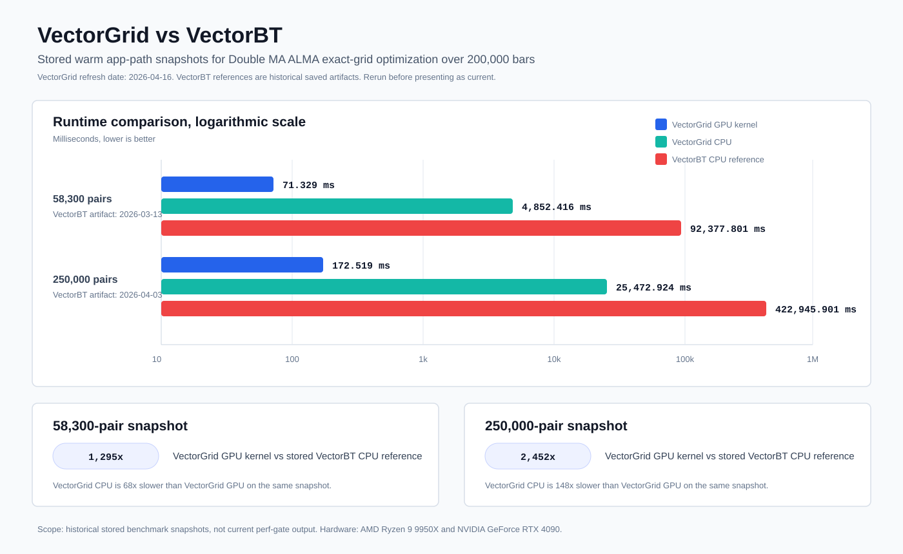

# VectorGrid

Rust backend and CLI for exact-grid trading strategy optimization and validation.

This public release is backend-only. The supported surface is the Rust backend crates, CLI commands, benchmark harnesses, and backend verification scripts. The frontend/Tauri desktop app is not the public run path for this release.

VectorGrid is research software. It is not financial advice, investment advice, or a production trading system.

## Quick Start

CPU-only synthetic `Double MA` run:

```powershell
cargo run -p ta_app_core --features cli --bin ta_cli -- `
  --backend cpu `
  --synth-len 1000 `
  --fast-ma alma `
  --slow-ma alma `
  --fast-period 5:15:5 `
  --slow-period 20:40:10 `
  --heatmap-bins 0 `
  --top-k 3
```

Optional GPU-kernel run:

```powershell
cargo run -p ta_app_core --release --features cli,cuda,cuda-backtest-kernel --bin ta_cli -- `
  --backend gpu-kernel `
  --synth-len 200000 `
  --fast-ma alma `
  --slow-ma alma `
  --fast-period 5:50:1 `
  --slow-period 20:200:5 `
  --heatmap-bins 0 `
  --top-k 10
```

## Verify

```powershell
powershell -ExecutionPolicy Bypass -File scripts/run_backend_release_gate.ps1
```

Compile benchmark harnesses without running benchmarks:

```powershell
cargo bench -p ta_app_core --no-run
```

## Benchmarks



Treat those numbers as historical snapshots. Rerun the matching benchmark scripts before presenting them as current results.

## License

See [LICENSE](LICENSE).
