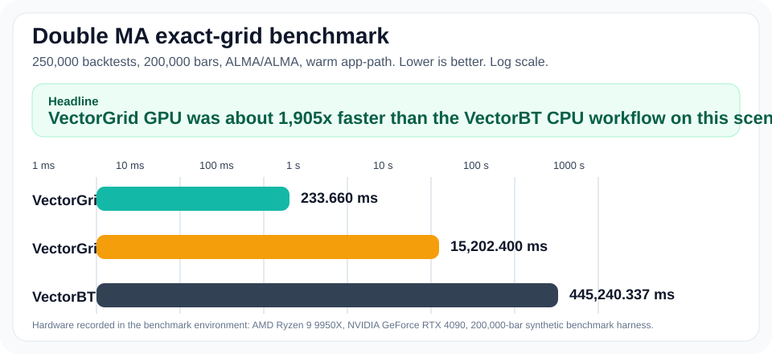

# VectorGrid

GPU-accelerated Tauri desktop app for exact-grid trading strategy optimization and validation.

The desktop product and the benchmarked execution engine are both referred to as **VectorGrid** in this repository. `VectorBT` is mentioned only for explicit external benchmark comparisons.

## Historical Benchmark Snapshots

These figures are saved faceoff artifacts, not current perf-gate outputs. Every number below is a **warm app-path** snapshot tied to a specific scenario, timing boundary, and saved artifact date.

**Fastest saved warm app-path snapshot (`2026-03-13` artifacts)**

- Scenario: `Double MA`, `ALMA/ALMA`, exact grid
- Workload: `58,300` backtests over `200,000` bars
- Timing boundary: warm app-path faceoff, same-thread, dataset already loaded
- Hardware: `AMD Ryzen 9 9950X`, `NVIDIA GeForce RTX 4090`
- VectorGrid GPU kernel: `101.886 ms`
- VectorGrid CPU: `3486.134 ms`
- VectorBT CPU workflow: `92377.801 ms`

Saved comparison ratios from those artifacts:

- `907x` faster than the measured VectorBT CPU workflow
- `34x` faster than the app's own CPU path on the same scenario

**Latest saved `250,000`-pair warm app-path rerun (`2026-04-03` artifacts)**

- Scenario: `Double MA`, `ALMA/ALMA`, exact grid
- Workload: `250,000` backtests over `200,000` bars
- Timing boundary: warm app-path faceoff, same-thread, dataset already loaded
- Hardware: `AMD Ryzen 9 9950X`, `NVIDIA GeForce RTX 4090`
- VectorGrid GPU kernel: `166.896 ms`
- VectorGrid CPU: `25709.363 ms`
- VectorBT CPU workflow: `422945.901 ms`

Saved comparison ratios from those artifacts:

- `2534x` faster than the latest saved VectorBT CPU workflow
- `154x` faster than the latest saved VectorGrid CPU path on the same scenario



_The chart above is the earlier March public `250,000`-pair warm app-path snapshot. The bullets above lead with the fastest saved snapshot and the latest heavier rerun set, both with explicit artifact-date context._

**Saved benchmark snapshots**

| Scenario | VectorGrid GPU kernel | VectorGrid CPU | VectorBT CPU |
| --- | --- | --- | --- |
| `200k bars / 58,300 pairs` | `101.886 ms` | `3486.134 ms` | `92377.801 ms` |
| `200k bars / 250,000 pairs` | `166.896 ms` | `25709.363 ms` | `422945.901 ms` |
| `200k bars / 250,000 pairs (March public chart)` | `233.660 ms` | `15202.400 ms` | `445240.337 ms` |

## What This Measures

These README benchmark snapshots are **warm app-path** faceoff numbers, not the tighter Criterion microbenchmark and not the CPU/GPU perf-gate outputs.

- Dataset is loaded once.
- Warmup runs happen before measured trials.
- GPU measured trials reuse resident market-series buffers.
- The `58,300`-pair and `250,000`-pair snapshots use `top_k=10` and `heatmap_bins=0`.
- The latest `250,000`-pair rerun set uses the real-workflow `10`-row benchmark lane.
- VectorBT is measured as a CPU Python workflow on `vectorbt 0.28.4`, with local ALMA generation and local metric aggregation that keeps the faceoff semantics aligned with the app's next-bar workflow.
- Treat the scenario identity and saved-artifact date above as part of the claim. If you need a current number, rerun the matching faceoff scenario instead of reusing the saved snapshot prose.

This repo also has a tighter engine benchmark boundary for the classic `58,300`-pair ALMA case:

- Criterion anchor: `double_ma/gpu_kernel/alma_alma/200k/large/58300pairs`
- Historical anchor: about `89 ms`

Use the warm app-path numbers only for scenario-matched saved-snapshot comparisons with explicit artifact/date context. Use the Criterion benchmark for lower-level engine tracking.

Local preserved benchmark, profiling, and report artifacts now belong under `output/`. Treat `target/` as disposable Cargo/build scratch that can be deleted between runs without intentionally preserving historical evidence.

## What The App Does

- Exact-grid optimization for trading strategies, with a mature GPU path for the `Double MA` family.
- GPU-backed validation coverage for the active supported strategy families, including walk-forward and related validation flows.
- CPU fallback support throughout the product.
- Warm in-memory and VRAM-resident execution paths designed for repeated optimization and validation runs on the same dataset.
- Desktop UI for data loading, optimization, shortlist review, heatmaps, validation, history, and export/report workflows.

## Current GPU Coverage

Broadly, the repo is in a good backend state for the current target set.

- Mature `DoubleMa` GPU optimization and validation path.
- `CompositeTrend`, `BreakoutMomentum`, and `RegimeHybrid` route through the `DoubleMa` product path.
- Composite-side GPU support exists for `ASR`, `ROCB`, `VEMR`, `MKCS`, `KQSR`, `CARM`, `KVDF`, and `CDMC`.
- `VCC` remains parity-gated.
- `CompositeMo` remains CPU-bound.

For the current detailed tracker set, see:

- [OPEN_IMPLEMENTATION_COMPLETION_TRACKER_2026-03-12.md](research/OPEN_IMPLEMENTATION_COMPLETION_TRACKER_2026-03-12.md)
- [GPU_VALIDATION_MIGRATION_PLAN_2026-03-10.md](research/GPU_VALIDATION_MIGRATION_PLAN_2026-03-10.md)
- [VALIDATION_HARDENING_PLAN_2026-03-10.md](research/VALIDATION_HARDENING_PLAN_2026-03-10.md)
- [STRATEGY_INDICATOR_GPU_COVERAGE_INVENTORY_2026-03-10.md](research/STRATEGY_INDICATOR_GPU_COVERAGE_INVENTORY_2026-03-10.md)

## Quick Start

Install frontend dependencies:

```powershell
cd web
npm install
```

Run the app from the repo root:

```powershell
npm --prefix web run build
cargo run -p ta_desktop_demo_app --release --features cuda,cuda-backtest-kernel
```

CPU-only app run:

```powershell
cargo run -p ta_desktop_demo_app --release
```

For Windows build variants, PTX packaging, and public release posture, use [RELEASE.md](RELEASE.md).

## Local Quality Gate

Use the repo-level quality gate before handoff for broad non-options changes and public-facing cleanup:

```powershell
powershell -ExecutionPolicy Bypass -File scripts/run_repo_quality_gate.ps1
```

The default lane runs:

- `cargo fmt --all -- --check`
- `cargo check --workspace`
- `cargo clippy --workspace --all-targets --no-deps`
- `npm --prefix web run lint`
- `npm --prefix web run typecheck`

Add desktop-harness type checking when desktop test code changes:

```powershell
powershell -ExecutionPolicy Bypass -File scripts/run_repo_quality_gate.ps1 -IncludeDesktopTypecheck
```

Add workspace tests for higher-risk backend or cross-layer changes:

```powershell
powershell -ExecutionPolicy Bypass -File scripts/run_repo_quality_gate.ps1 -IncludeWorkspaceTests
```

Use `-StrictClippy` only when you explicitly want warnings treated as errors. The repo is not yet warning-free under Clippy, so the default lane keeps Clippy advisory while still making it part of the public quality bar.

For contributor-facing routing, verification ownership, and the broader workflow map, use `REPO_MAP.md` rather than expanding this README into a routing document.

For public contribution, support, security-reporting, and license terms, use `CONTRIBUTING.md`, `SUPPORT.md`, `SECURITY.md`, and `LICENSE`.

## Reproduce The Benchmark

Prepare the dedicated faceoff environment before refreshing any reusable VectorBT comparison artifact:

```powershell
py -m venv .venv-vectorbt-faceoff
.\.venv-vectorbt-faceoff\Scripts\python.exe -m pip install --upgrade pip
.\.venv-vectorbt-faceoff\Scripts\python.exe -m pip install -r scripts/requirements-vectorbt-faceoff.lock.txt
```

Run the real-workflow `250,000`-pair warm faceoff scenario with the same interpreter explicitly:

```powershell
powershell -ExecutionPolicy Bypass -File scripts/run_vectorbt_vs_vectorgrid_faceoff.ps1 `
  -ScenarioPath scripts/vectorbt_double_ma_faceoff_scenario_real_workflow_250k.json `
  -OutDir output/benchmarks/vectorbt_vs_vectorgrid_faceoff_250k_real_workflow `
  -PythonExe .\.venv-vectorbt-faceoff\Scripts\python.exe
```

Scenario file:

- [scripts/vectorbt_double_ma_faceoff_scenario_real_workflow_250k.json](scripts/vectorbt_double_ma_faceoff_scenario_real_workflow_250k.json)

The saved artifacts currently reflected in the README are historical snapshots. Rerun the matching scenario before repeating the numbers as current.

Each faceoff run now writes the lockfile hash plus same-interpreter Python provenance into the output directory and `summary.json`:

- `python-freeze.txt`
- `python-pip-version.txt`
- `summary.json` `environment.python.requirements_lock`
- `summary.json` `environment.python.pip`

Preserved faceoff artifacts now belong under `output/benchmarks/`. Older historical snapshots may still exist under legacy `target/...` paths from before this convention.

- fastest saved `58,300`-pair snapshot:
  - `output/benchmarks/vectorgrid_app_faceoff_only_20260313/`
  - `output/benchmarks/vectorbt_vs_vectorgrid_faceoff_58300_rerun/`
- latest saved `250,000`-pair rerun set:
  - `output/benchmarks/vectorbt_vs_vectorgrid_manual_rerun_2026-04-03/`
  - `output/benchmarks/vectorbt_vs_vectorgrid_faceoff_rerun_2026-04-03/`
- March public `250,000`-pair chart snapshot:
  - `output/benchmarks/vectorgrid_app_faceoff_only_250k_20260313/`
  - `output/benchmarks/vectorbt_only_faceoff_250k_20260313/`

## Performance Gates And Profiling

CPU perf gate:

```powershell
powershell -ExecutionPolicy Bypass -File scripts/run_cpu_perf_gate.ps1 -Mode candidate
```

GPU perf gate:

```powershell
powershell -ExecutionPolicy Bypass -File scripts/run_gpu_perf_gate.ps1 -Mode candidate
```

ALMA contract-row GPU perf gate:

```powershell
powershell -ExecutionPolicy Bypass -File scripts/run_gpu_alma_contract_rows_perf_gate.ps1 -Mode candidate
```

Nsight Compute capture:

```powershell
powershell -ExecutionPolicy Bypass -File scripts/profile_gpu_backtest_ncu.ps1
```

## Repo Layout

- `src-tauri/`: Tauri app crate, commands, desktop integration
- `crates/app_core/`: optimization, validation, CUDA/runtime plumbing
- `crates/strategies/`: strategy configuration and shared strategy logic
- `crates/optimizer/`: optimizer support crate
- `web/`: Vue 3 + Vite frontend
- `research/`: trackers, migration plans, benchmark notes, and implementation docs

## Notes

- Keep CPU-only builds working; CUDA is optional at build time.
- For CUDA backtest-kernel work, use the repo perf gates and Nsight before drawing conclusions from single ad-hoc timings.
- The current benchmark chart is intentionally static and explicit. It is meant to be readable and honest in a GitHub README without relying on video playback.
