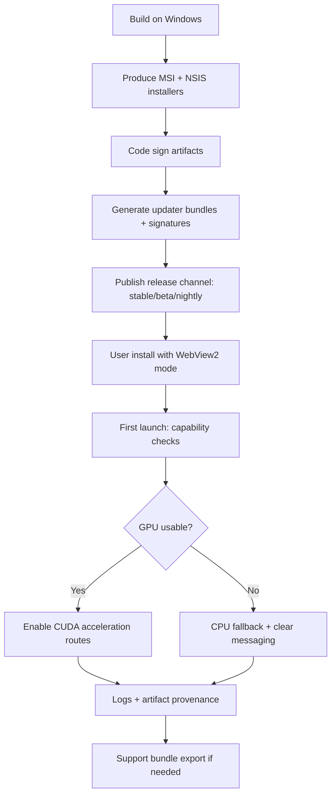

# Deep research on DR-12 in the VectorGrid question pack

## Locating the file and extracting the question

The file **`VECTORGRID_DEEP_RESEARCH_QUESTION_PACK_2026-04-09.md`** is available locally as an uploaded Markdown document, and it is explicitly dated **2026-04-09** inside the file. fileciteturn0file3

**Exact text of question 12 (DR-12):** fileciteturn0file3

> For a Windows-first Tauri desktop app with optional CUDA acceleration, what are the best practices for packaging, capability detection, crash diagnosis, support policy, and user messaging? Compare prebuilt PTX, optional local CUDA toolchain assumptions, GPU capability checks, CPU fallback posture, installer disclosure, and log/telemetry collection. Focus on user-visible supportability and release policy rather than code-level implementation detail, and say clearly which recommendations already follow from official Tauri guidance versus broader desktop-app practice.

## Executive summary

This question is asking for **release-policy-level best practices** (not a CUDA-kernel refactor) for a **Windows-first** desktop app built on Tauri, where GPU acceleration is **optional** and **CPU-only** usage must remain reliable. fileciteturn0file3turn0file5

The most defensible “supportable delivery” posture for an optional-CUDA Tauri desktop app is:

- Use **Tauri’s standard Windows installers (MSI + NSIS)** and **Tauri’s updater artifacts**, and treat **code signing** as a first-class part of “supportability” (reducing SmartScreen friction and enabling store distribution). citeturn3view0turn4view2turn4view0turn3view2turn3view1  
- Make **WebView2/runtime provisioning** an explicit installer decision (bootstrapper vs offline vs fixed runtime), and disclose size + offline implications clearly. citeturn4view4turn3view4turn3view5  
- For CUDA delivery, prefer **“no local CUDA toolkit required for end users”** and treat “PTX vs cubin (SASS)” as a **compatibility + startup-latency** policy tradeoff: PTX improves forward GPU coverage via JIT, while cubins reduce first-run JIT and can align with some compatibility expectations. citeturn5view0turn3view7turn3view6turn5view1  
- Implement capability detection as **a user-visible contract**: show what GPU route is available, why GPU is unavailable (driver/GPU/feature mismatch), and what fallback is happening. NVIDIA’s compute capability discovery guidance and CUDA JIT environment variables provide concrete “support playbook” hooks. citeturn8view0turn3view7turn5view0  
- For crash diagnosis and support, ship **local-first logs** by default (Tauri logging plugin), plus an optional, clearly explained “support bundle” workflow; optionally add minidumps for hard crashes if support load warrants it. citeturn3view3turn8view1turn8view2turn8view3

Tailoring to VectorGrid specifically: your repo posture already emphasizes **CPU-only support**, **route/fallback transparency**, and the presence of **prebuilt PTX** controls; the best-fit recommendations are mostly about making those realities **operator-visible**, **installer-visible**, and **support-workflow-visible** rather than adding new compute features. fileciteturn0file0turn0file2turn0file5

## Intent and scope interpretation

The prompt is best interpreted as a request to define an **end-to-end “supportable distribution contract”** for an optional-CUDA desktop app:

- **Packaging** means: Windows installer outputs, dependency bundling choices, update distribution mechanics, signing, and release channels (stable/beta/nightly) from a user perspective. citeturn3view0turn3view2turn3view1  
- **Capability detection** means: runtime checks that decide whether to run GPU code (and which GPU path) or fall back to CPU, communicated in UI, logs, and artifacts. citeturn8view0turn5view0  
- **Crash diagnosis** means: what evidence a user/support person can gather (logs, repro context, backtraces, minidumps) and how the app guides them to do it. citeturn3view3turn8view1turn8view2  
- **Support policy and messaging** means: what configurations are supported, what is best-effort, what is out-of-scope, and how the app words that without undermining trust (especially around GPU acceleration, JIT compilation, and fallbacks). fileciteturn0file3turn0file5

Two important VectorGrid constraints are explicitly relevant:

- VectorGrid’s deep-research program and architecture notes emphasize **CPU-only builds must remain supported** and changes should prefer additive, support-oriented improvements. fileciteturn0file0turn0file5  
- The repo already documents **prebuilt PTX** controls and indicates GPU builds can avoid requiring a local CUDA toolkit when using the prebuilt PTX path. fileciteturn0file2  

## Best practices for packaging and delivery

### Windows installer strategy that remains supportable

**What’s directly from official Tauri guidance**

- Tauri’s Windows distribution flow is built around producing installers via `tauri build` on Windows. citeturn3view0  
- Tauri supports both **MSI** and **NSIS** installer outputs; MSI is built using **WiX Toolset v3** and can be customized, and NSIS can also be customized. citeturn4view2turn4view0  
- Tauri’s Windows installer docs also explicitly cover bundling prerequisite installers and recommend checking whether a dependency is already installed (e.g., via registry keys) and using silent install flags where appropriate. citeturn4view1  

**Broader desktop-app practice (applied to Tauri outputs)**

A supportable policy usually looks like:

- **Offer MSI and NSIS**, but standardize messaging around what each is “for.” MSI is commonly preferred for enterprise deployment tooling (GPO/SCCM/Intune patterns), while NSIS is common for consumer installer UX. (This is “desktop convention,” not a Tauri-specific rule; confirm your user base before committing.) citeturn4view2turn4view0  
- Ensure your release notes and download page clearly state:
  - Required Windows versions you support (and whether Windows 7 is in or out).
  - Whether the installer includes WebView2 provisioning and which mode.
  - Whether “GPU acceleration” is included and what users need for it (NVIDIA driver + GPU). citeturn4view4turn3view4turn5view0  

### WebView2 provisioning is part of your support contract

**What’s directly from official Tauri guidance**

Tauri documents multiple **WebView2 installation modes** for Windows installers (download bootstrapper, embedded bootstrapper, offline installer, fixed version, skip) and provides size/behavior tradeoffs, including that “skip” is not recommended. citeturn4view4  
Tauri’s docs also note that on Windows 10 (April 2018 release or later) and Windows 11, the WebView2 runtime is distributed as part of the OS. citeturn4view4  

**What’s directly from Microsoft’s guidance**

Microsoft’s WebView2 docs recommend Evergreen mode for most apps and distinguish Evergreen vs Fixed Version distribution. citeturn3view4turn3view5  

**Best-fit policy for a Windows-first research desktop app**

- Default to **Evergreen** (bootstrapper / embedded bootstrapper) for general users, because it offloads runtime updating to the system and reduces the odds of “stuck on a vulnerable WebView2” situations. citeturn3view4turn4view4  
- Provide an **offline-capable installer variant** (or a documented mode) for institutional/offline environments, recognizing that it increases installer size substantially. citeturn4view4turn3view5  
- Only ship a **fixed WebView2 runtime** if you have a concrete need: regulated environments, strict reproducibility constraints, or avoiding runtime drift for a validated build—accepting a significant size increase and the burden of updating that runtime yourself. citeturn3view4turn3view5turn4view4  

### Code signing and update artifacts are not optional if you want low-friction support

**What’s directly from official Tauri guidance**

Tauri’s Windows code signing docs explicitly frame signing as required to avoid SmartScreen trust issues and to be listed in the Microsoft Store. citeturn3view1  

**Best-fit policy**

- Treat signing as part of your **“supportability baseline”** rather than a release nice-to-have.
- Sign **all** distributed installer artifacts consistently (and ensure your updater artifacts align with your signing model), because “I can’t install it” is a support failure regardless of how correct your CUDA kernels are. citeturn3view1turn3view2  

(Where this is partly product judgment: whether you require signing for nightly builds. Many teams sign stable/beta only and keep unsigned nightlies for internal testers.)

### Tauri updater alignment with MSI/NSIS distribution

**What’s directly from official Tauri guidance**

Tauri’s updater plugin documentation describes Windows updater artifacts and indicates Tauri produces MSI/NSIS installers plus associated updater bundles/signatures (including `.sig`). citeturn3view2  

**Best-fit policy**

- Pick a **single primary update channel** (stable) with an explicit opt-in for prerelease channels (beta/nightly), and bake that into your UI (e.g., “Receive prerelease updates”). This reduces “support doesn’t know what build I’m on.” citeturn3view2  
- Keep your update mechanism consistent across MSI and NSIS. If you ship both installer types, ensure your updater policy is well-defined for both, because “updater works only for NSIS” (or only MSI) is a common source of user confusion. citeturn3view2  

### A concrete release flow diagram

## Best practices for optional CUDA delivery, capability detection, and crash diagnosis

### CUDA “packaging” is really about compatibility, first-run latency, and support evidence

This is the core comparison requested by the question: **prebuilt PTX** vs “requires local CUDA toolkit” vs other packaging choices.

#### PTX, cubins (SASS), and fatbins

**Established CUDA model (authoritative NVIDIA guidance)**

- NVIDIA describes PTX as enabling **JIT compilation for the GPU it’s loaded on**, improving cross-architecture compatibility (with the constraint that PTX cannot be JIT-compiled for compute capabilities below the PTX target). citeturn5view0  
- CUDA also supports bundling multiple cubins and PTX in a **fatbin**, which is the standard mechanism for “run fast on known GPUs, still run on future GPUs.” citeturn5view0turn5view1  
- Classic binary compatibility rules apply: cubins are compatible within certain compute capability constraints, and PTX compiled for a given compute target can be compiled to binaries for equal-or-higher compute capability (with caveats about architecture-specific targets). citeturn5view1turn5view0  

**Supportability consequences**

- **PTX-first** distribution shifts failures into:
  - “Driver too old for this PTX/toolkit era” (a real-world support issue).
  - “First run is slow” due to JIT compilation.
  - “JIT cache can’t be written” in locked-down environments. citeturn3view7turn5view0  
- **Cubin-first** distribution shifts failures into:
  - “Your GPU architecture isn’t included” (no compatible cubin).
  - “New GPU generation isn’t supported until we ship an update.” citeturn5view0turn5view1  

A frequently best practice (when you care about both) is “**fatbin policy**”: ship cubins for the most common/important architectures + a PTX fallback for forward compatibility. This is consistent with CUDA’s compilation/compatibility model, though implementing it may be more involved for a Rust/CUDA integration depending on how kernels are loaded. citeturn5view0turn5view1  

#### Minor/forward compatibility and what NVIDIA’s compatibility docs imply

NVIDIA’s CUDA Compatibility documentation distinguishes backwards/minor/forward compatibility cases and notes, in the minor-version compatibility scenario, “**No PTX (requires SASS)**” as part of the requirements table. citeturn3view6  

Practical interpretation for a desktop app (inference grounded in the above docs):

- If your delivery model relies heavily on **PTX-only**, you should expect to enforce a clearer **minimum driver requirement** and make driver upgrade messaging first-class, because compatibility expectations differ from “runtime-only” scenarios. citeturn3view6turn5view0  
- If you include **SASS/cubins** for common targets, you can reduce reliance on PTX JIT at install/first run and sometimes reduce “mysterious first-run performance issues.” citeturn5view0turn3view7  

### “Do not require a local CUDA toolkit” is usually the right end-user policy

For a Windows desktop app, requiring end users to have a full CUDA toolkit installed is typically a non-starter for supportability. The app should depend on the NVIDIA driver/runtime presence, not a dev toolchain.

VectorGrid’s repo documentation already indicates a posture consistent with this: it documents **prebuilt PTX** controls and states GPU builds can avoid requiring a local CUDA toolkit when prebuilt PTX is used. fileciteturn0file2  

So, the best-practice policy for VectorGrid-like delivery is:

- **Developers/build machines**: you may require the toolkit to build kernels (or to regenerate PTX/cubins).  
- **End users**: never require an NVCC toolchain; instead, require a supported NVIDIA driver and GPU capabilities, and be explicit about what is optional acceleration. citeturn5view0turn3view6turn8view0  

### Capability detection that is “support-grade,” not “silent failure”

Capability detection should be treated as a contract across four surfaces:

- **UI** (what the user sees)
- **Logs** (what support sees)
- **Artifacts** (what future-you sees when reviewing results)
- **Release notes/support matrix** (what users can check before installing)

**Minimum viable capability checks (with authoritative anchors)**

- Detect “GPU present and usable” and record **compute capability** and device identity. NVIDIA documents multiple ways to obtain compute capability (runtime API, driver API, NVML, `nvidia-smi`). citeturn8view0  
- When PTX JIT is involved, understand and expose where JIT caching can fail and how it can be influenced; CUDA documents `CUDA_CACHE_PATH` and also provides `CUDA_FORCE_PTX_JIT` / `CUDA_DISABLE_PTX_JIT` as explicit toggles that can be used for validation and troubleshooting. citeturn3view7  

**Support-grade user messaging patterns (partly product judgment)**

A robust UI pattern is:

- A “Compute / Acceleration Status” panel that reports:
  - Build lane: CPU-only vs CUDA-enabled build.
  - Selected execution backend (Auto → chosen backend).
  - GPU detection results (device name, compute capability, driver version).
  - Whether PTX JIT was used or a precompiled path was used.
  - Any fallback reason codes (e.g., “No compatible GPU,” “Driver too old,” “JIT cache not writable,” “Insufficient VRAM,” “Kernel load failed”). citeturn8view0turn5view0turn3view7  

VectorGrid’s general product philosophy emphasizes route transparency (“what actually happened”), so aligning messaging with that posture is consistent with existing repo goals. fileciteturn0file0turn0file5  

### Crash diagnosis and diagnostics collection

#### Local-first logging

**What’s directly from official Tauri guidance**

Tauri’s logging plugin defaults to logging to stdout and to a file in the application logs directory, with configurable targets. citeturn3view3  

**Best-fit support posture**

- Make “Export diagnostics” a first-class action that bundles:
  - app logs (from the app logs directory),
  - the current “capability report” (GPU/driver/WebView2 mode),
  - the last N run summaries and route metadata (your local-first model),
  - and minimal environment metadata (app version, channel). citeturn3view3turn3view7turn8view0  

(You can keep this privacy-respecting by default: store locally, and only share when the user elects to.)

#### Backtraces for Rust panics

Rust’s `Backtrace` capture behavior depends on environment variables like `RUST_BACKTRACE` / `RUST_LIB_BACKTRACE`, and Rust documents that capturing backtraces can be expensive—so these are ideal as “support-mode toggles,” not always-on overhead. citeturn8view1  

Practical policy:

- In normal mode, capture minimal panic context + route/context IDs.
- In support mode, enable richer backtraces and include them in the support bundle. citeturn8view1  

#### Minidumps for hard crashes

For native desktop apps with “real” crashes (segfaults, GPU driver faults, etc.), minidumps are a well-established technique. entity["organization","Mozilla","nonprofit foundation"]’s description of their Rust minidump work provides useful rationale for why minidumps exist and how they’ve been used across platforms. citeturn8view2  
A Rust-focused crash reporting survey describes out-of-process minidump generation (e.g., via a monitoring process) and the value of richer “breadcrumbs” context. citeturn8view3  

Best-fit policy for a local-first research tool:

- Start with logs + capability report.
- Add minidumps only if support needs demonstrate that panics/logs are insufficient (for example, GPU driver-level crashes). citeturn8view2turn8view3  

### Where VectorGrid’s existing repo posture fits

From the repo routing documentation, VectorGrid already acknowledges:

- CPU-only and GPU build variants, and a prebuilt PTX artifact path. fileciteturn0file2  
- A design emphasis on route semantics like CpuOnly/GpuOnly/GpuKernel/GpuHybridKernel, which naturally extends into “support-grade” provenance and messaging. fileciteturn0file5turn0file2  

So the most “repo-fit” improvements tend to be:

- Better default disclosure (installer and UI),
- better diagnostics packaging,
- and better, standardized reason codes for GPU unavailability  
rather than changing kernel internals.

## Comparison table of alternative approaches

| Decision axis | Approach | Main advantages | Main drawbacks | Best-fit guidance for VectorGrid-style constraints |
|---|---|---|---|---|
| Windows installer | MSI (WiX) | Strong enterprise deployment story; formal Windows installer semantics; customizable via WiX | More complex customization surface | Ship MSI to support enterprise/institutional users; maintain customization discipline. citeturn4view2 |
| Windows installer | NSIS | Common consumer installer UX; also customizable | Different enterprise acceptability; separate installer “feel” | Ship NSIS alongside MSI if you serve both audiences; keep messaging consistent. citeturn4view0 |
| WebView2 provisioning | Evergreen bootstrapper / embedded bootstrapper | Smaller installer; runtime updates handled by system | Internet dependency during install for bootstrapper approaches | Default for most users; document offline alternative. citeturn3view4turn4view4 |
| WebView2 provisioning | Offline installer / fixed runtime | Works offline; fixed runtime improves reproducibility control | Large size impact; you must manage updates for fixed runtime | Provide as an explicit “offline/institutional” option; avoid silent surprises about size. citeturn3view5turn4view4 |
| CUDA kernel packaging | PTX-first | Forward GPU coverage via JIT; fewer per-arch binaries | First-run JIT latency; driver/PTX-version friction; cache/write issues | Good default if you strongly value forward compatibility, but pair it with strong capability reporting + clear driver guidance. citeturn5view0turn3view7 |
| CUDA kernel packaging | Cubin/SASS-first | Faster startup; less reliance on JIT | Limited forward coverage; requires shipping per-arch binaries | Useful as a “reduce JIT pain” move for common GPUs; consider pairing with PTX fallback if feasible. citeturn5view0turn5view1 |
| CUDA kernel packaging | Fatbin (cubins + PTX) | Best of both: fast on common GPUs + forward fallback | More build complexity; larger artifacts | Often the highest-quality support posture if the build/release pipeline can bear it. citeturn5view0turn5view1 |
| Diagnostics | Logs only | Simple; privacy-friendly | Hard to debug hard crashes; less context | Baseline requirement; ensure easy export and clear paths. citeturn3view3 |
| Diagnostics | Logs + backtraces | Better panic debugging | Backtraces can be expensive if always-on | Use a “support mode” toggle; include in support bundle. citeturn8view1 |
| Diagnostics | Logs + minidumps | Can diagnose hard crashes and native faults | More engineering; privacy considerations | Add only if real crash patterns demand it; keep opt-in/transparent. citeturn8view2turn8view3 |

## Prioritized sources and assumptions

### Prioritized sources

- Tauri v2 Windows distribution and installer guidance (MSI/WiX, NSIS, dependency bundling, WebView2 installation modes). citeturn3view0turn4view2turn4view0turn4view4  
- Tauri v2 Windows code signing guidance. citeturn3view1  
- Tauri v2 updater plugin documentation (Windows updater artifacts and signatures). citeturn3view2  
- Tauri v2 logging plugin documentation (file logging defaults and targets). citeturn3view3  
- Microsoft WebView2 distribution documentation (Evergreen vs fixed runtime, distribution tradeoffs). citeturn3view4turn3view5  
- NVIDIA CUDA docs on compatibility, PTX JIT, compute capability discovery, and JIT environment variables/caching. citeturn3view6turn5view0turn8view0turn3view7  
- Rust standard library documentation for backtrace capture behaviors and performance implications. citeturn8view1  
- Crash/minidump practice references for native apps (Mozilla + Rust crash reporting survey). citeturn8view2turn8view3  

### Assumptions and constraints noted

- The file was accessible locally as an uploaded Markdown document; no GitHub/institutional lookup was required. fileciteturn0file3  
- Some recommendations (e.g., whether to ship separate CPU-only vs CUDA-enabled installers, or how aggressive to be about minidumps) are **product/support judgment calls** and depend on VectorGrid’s real user base and support load; they are not dictated by a single external standard. fileciteturn0file0turn0file5  
- CUDA packaging guidance depends on exactly how kernels are embedded/loaded in the app; this report intentionally focuses on **policy and messaging** rather than kernel implementation details, consistent with DR-12’s scope. fileciteturn0file3