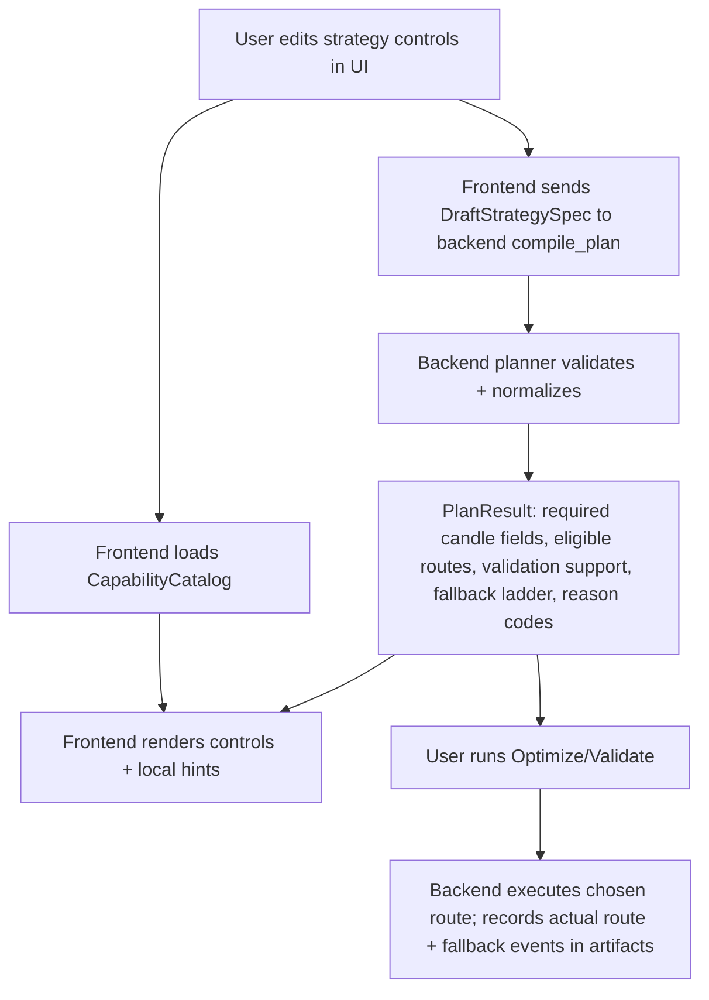
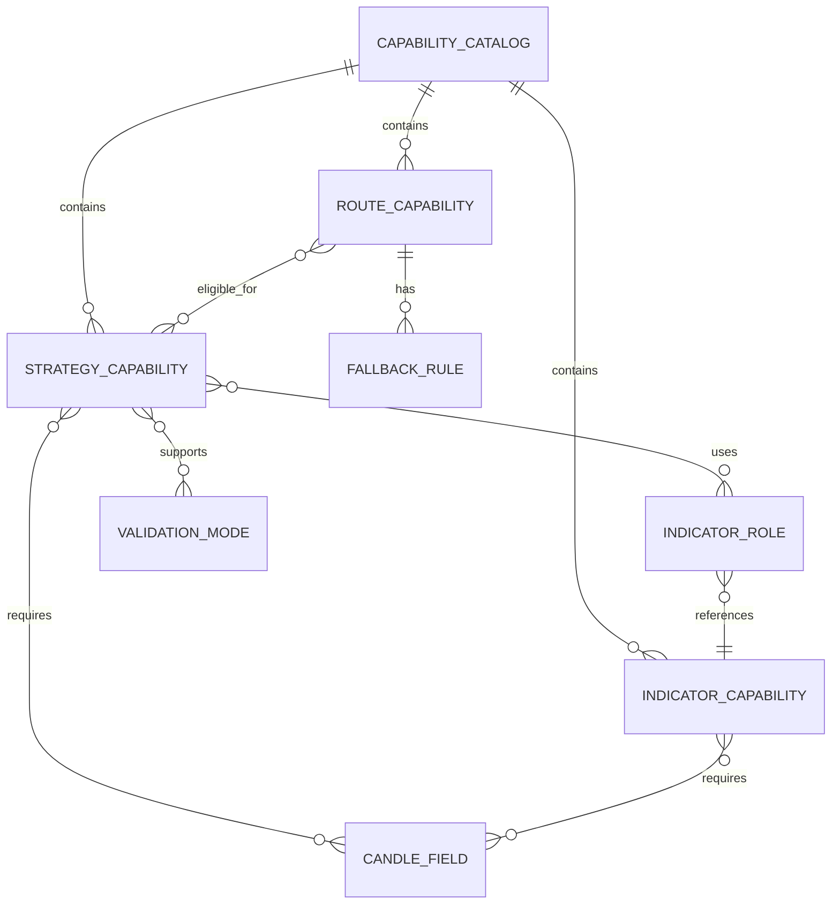

# Capability Modeling to Prevent Frontend–Backend Drift in VectorGrid

## Executive summary

A capability model that **minimizes frontend/backend drift** for a constrained strategy builder is best treated as a **planner/compiler contract**, not as duplicated UI rules. The most robust pattern is a **backend-owned, versioned capability catalog + a “compile/plan” endpoint** that evaluates an in-progress strategy specification (and current runtime environment) and returns: (a) required candle fields, (b) eligible execution routes, (c) validation support, and (d) fallback behavior with reason codes. The frontend becomes a **thin consumer** of this catalog/plan output for gating controls and rendering warnings, while the backend remains the **authoritative type-checker and planner**. This mirrors how mature systems prevent drift via **schema discovery/introspection** (GraphQL), **resource discovery + schema** (Kubernetes), and **catalog-driven planning** (query engines like DataFusion and Calcite). citeturn1search2turn1search3turn1search0turn0search7

Concretely for a Rust + TypeScript desktop app, the lowest-friction way to keep types aligned is to **generate TypeScript types and JSON Schemas from Rust** (e.g., `ts-rs` for TS bindings and `schemars` for JSON Schema), and use JSON Schema (or a JSON-Schema-derived runtime validator) as the shared “shape + constraints + UI hints” layer. JSON Schema explicitly serves validation and can provide “hints for user interfaces working with JSON data,” which is directly relevant for building honest, drift-resistant control panels. citeturn0search4turn0search1turn2search7turn2search0

Recommended VectorGrid outcome under the question pack’s decision framing: **Implement Now** (but as an additive slice), **Change shape: Mostly Additive** (because it introduces a new catalog/plan contract but can be adopted incrementally). The most important discipline is to encode **fallback honesty** as structured outputs (reason codes + provenance fields) rather than UI prose, and to ensure artifacts record the *actual* route taken, not just the requested route.

## Exact question from the pack

Extracted from `/mnt/data/VECTORGRID_DEEP_RESEARCH_QUESTION_PACK_2026-04-09.md` (13th question = DR-13):

> “What capability-model pattern is most likely to reduce frontend/backend drift in a constrained strategy builder that must keep controls honest about candle-field requirements, indicator support, route eligibility, validation support, and fallback behavior? Compare patterns from compilers, query planners, analytics engines, and typed feature registries, but keep the answer grounded in practical schemas and ownership boundaries rather than abstract framework design. If external precedent is weak, say so explicitly and fall back to a smaller set of transferable design rules.”

## Direct answer

### Concise answer

Use a **backend-owned capability catalog + plan/compile API**:

- **Catalog**: a versioned, machine-readable registry of strategies/indicators/routes with required candle fields, parameter schemas, eligible routes, validation support, and fallback rules.
- **Compile/plan**: given a draft strategy spec + desired route policy + runtime context (GPU availability/build flags), the backend returns a **PlanResult** containing eligibility/warnings/errors and normalized choices.
- **Frontend**: renders controls from the catalog, calls compile/plan as users edit, and displays warnings from backend reason codes. The frontend does *not* re-implement route eligibility logic.

This is the closest practical analogue to:
- **Query engines** using catalogs and planning-time validation (Calcite schemas; DataFusion catalog/schema/table hierarchies). citeturn0search7turn1search0
- **Schema introspection/discovery** as the contract used by tooling (GraphQL introspection; Kubernetes discovery + OpenAPI schema separation). citeturn1search2turn1search3

### Recommendation and change shape

- **Recommendation**: Implement Now (incremental adoption).
- **Change shape**: Mostly Additive (new catalog/plan command surface; existing request builders can gradually defer to it).
- **Smallest credible slice**: start with candle-field requirements + indicator support + route eligibility, then add validation support and fallback behavior in structured form.

## Evidence and reasoning

### Why this “catalog + planner” pattern reduces drift

Drift happens when **two places encode the same rules** (frontend gating + backend validation) and those rules evolve independently. A drift-resistant pattern forces a single “source of truth” and makes the other side a **consumer**:

- In GraphQL, clients can query the server schema via **introspection**, which powers tooling and validation; this is a concrete example of a server-defined contract that clients use rather than duplicate. citeturn1search2
- Kubernetes separates **Discovery** (what resources/verbs exist) from **OpenAPI** (resource schema), explicitly signaling a two-layer model: “brief summary of available resources” vs detailed schema. This is a useful analogue for VectorGrid splitting “what strategies/routes exist” from “detailed parameter/constraint schemas.” citeturn1search3
- Query planners like DataFusion describe catalogs/schemas/tables as a hierarchy and rely on that metadata to validate and build plans; Calcite’s `Schema` is explicitly a namespace for tables and functions. These are examples where the planner consults a canonical registry rather than hard-coding “what exists” in multiple layers. citeturn1search0turn0search7

This generalizes well to VectorGrid’s constraints, because “candle-field requirements,” “route eligibility,” and “validation support” are precisely the kinds of **planning-time constraints** that compilers/query planners check before execution.

### Why JSON Schema is a practical bridge for “honest controls”

JSON Schema is not only for validation; its validation vocabulary explicitly notes it can “provide hints for user interfaces working with JSON data.” That makes it a strong candidate format for expressing parameter shapes and constraints once and reusing them in UI form generation and request validation. citeturn2search7turn2search0

OpenAPI 3.1’s alignment with JSON Schema Draft 2020-12 further reinforces the ecosystem value of JSON-Schema-shaped contracts (tooling, validators, codegen). Even if VectorGrid is not an HTTP API, the same approach—**machine-readable schema + generated bindings**—is transferable. citeturn2search12turn0search2

### Why “generate TS from Rust” is the lowest-friction type-alignment step

For a Rust backend and TypeScript frontend, the common failure mode is parallel hand-written type definitions. Tooling like `ts-rs` exists explicitly to generate TypeScript bindings from Rust structs/enums so “types [stay] in one place,” and `schemars` exists to derive JSON Schema from Rust types via `#[derive(JsonSchema)]`. citeturn0search4turn0search24turn0search1turn0search21

This matters because a capability model will inevitably introduce shared data structures such as:

- `CapabilityCatalog`
- `StrategyCapability`
- `IndicatorCapability`
- `RouteEligibility`
- `PlanResult` / `ReasonCode`

If those stay Rust-native and are generated into TS, the frontend can compile against them (reducing “shape drift”), while the backend remains authoritative for meaning (reducing “semantic drift”).

### Comparison of capability-model patterns

| Pattern | Drift resistance | Handles complex route/fallback semantics | Runtime-awareness (GPU present, dataset fields) | Operational complexity | Fit for VectorGrid |
|---|---:|---:|---:|---:|---|
| Backend-owned **catalog + compile/plan API** (recommended) | High | High (reasons computed once) | High (planner uses runtime context) | Medium | Strong fit: mirrors planner systems; keeps UI honest |
| Build-time generated static catalog only (no runtime planning) | Medium–High (shape) | Medium (semantics may still leak into UI) | Low–Medium | Low–Medium | Good early step, but insufficient for fallback honesty |
| Shared JSON file manually edited by both sides | Medium | Medium | Low | Low | Too easy to drift; weak semantic authority |
| Protobuf-first contract + generated bindings everywhere | High (shape) | Medium–High | Medium | High | Overkill for Tauri IPC unless already adopted broadly |
| GraphQL-style schema + introspection endpoints | High (shape) | Medium | High | High | Strong conceptually, but heavy and misaligned with product boundaries |

Protocol Buffers are a proven “define once, generate bindings” mechanism, but adopting protobuf as the primary IDL is usually a bigger ecosystem decision than VectorGrid needs for a capability model. citeturn2search3

## Best fit for VectorGrid

### A practical capability schema that stays grounded

A capability model for VectorGrid should separate **stable catalog facts** from **computed planning results**:

- **Static catalog (build-time truth)**: what strategies, indicators, and routes exist in the build; parameter schemas; candle-field requirements as declarative sets; known incompatibilities.
- **Runtime capabilities**: GPU availability, kernel support flags, device properties (if relevant), and any build flags that constrain route choices.
- **Plan/eligibility result (computed, authoritative)**: for a draft request, enumerate per-route `{eligible, warnings, blockers}` with structured reason codes; compute fallback ladder.

This mirrors Kubernetes’ “Discovery API vs OpenAPI schema” split and GraphQL’s “schema as contract used by tools.” citeturn1search3turn1search2

### Mermaid diagrams for the recommended model





### Suggested minimal data structures

A useful minimum set of fields (expressible as Rust types → TS + JSON Schema) looks like this:

| Object | Key fields | Why it matters for drift |
|---|---|---|
| `IndicatorCapability` | `id`, `display_name`, `required_candle_fields`, `param_schema`, `supports_cpu`, `supports_gpu_sweep`, `supports_gpu_kernel` | UI auto-gates indicators and parameters based on truth |
| `StrategyCapability` | `kind`, `indicator_roles`, `required_candle_fields`, `route_constraints`, `validation_support_matrix` | Prevents UI offering impossible combos |
| `RouteCapability` | `route_id`, `requirements`, `fallback_targets`, `artifact_provenance_fields` | Makes execution policy explicit and auditable |
| `PlanResult` | `normalized_spec`, `required_fields`, `route_statuses[]`, `fallback_ladder`, `warnings[]`, `blockers[]` | UI shows backend-derived truth; artifacts can embed it |

JSON Schema is particularly effective for `param_schema` because it is designed for structural validation and can provide UI hints. citeturn2search7turn2search0

### Runnable example sketches

These examples are intended to be runnable with typical environments; they demonstrate the mechanics, not VectorGrid’s exact crate layout.

#### Rust: define once, generate TS + JSON Schema

Environment assumptions:
- Rust stable toolchain
- `serde`, `schemars`, `ts-rs` added to `Cargo.toml`

```rust
use serde::{Deserialize, Serialize};
use schemars::JsonSchema;
use ts_rs::TS;

#[derive(Debug, Clone, Serialize, Deserialize, JsonSchema, TS)]
#[ts(export)]
pub struct IndicatorCapability {
    pub id: String,
    pub display_name: String,
    pub required_candle_fields: Vec<CandleField>,
    pub supports_cpu: bool,
    pub supports_gpu_kernel: bool,
}

#[derive(Debug, Clone, Serialize, Deserialize, JsonSchema, TS)]
#[ts(export)]
pub enum CandleField {
    Open,
    High,
    Low,
    Close,
    Volume,
}

// In a test (common ts-rs workflow), export TS bindings:
// #[test]
// fn export_ts() {
//     IndicatorCapability::export().unwrap();
//     CandleField::export().unwrap();
// }
//
// For JSON Schema with schemars:
// let schema = schemars::schema_for!(IndicatorCapability);
// serde_json::to_string_pretty(&schema).unwrap();
```

Why this reduces drift:
- `ts-rs` is explicitly designed to generate TypeScript bindings so the frontend doesn’t maintain parallel definitions. citeturn0search4turn0search24
- `schemars` derives JSON Schema via `#[derive(JsonSchema)]`, enabling a single canonical schema for validation and UI hints. citeturn0search1turn0search21

#### TypeScript: consume backend catalog and plan results (thin UI)

Environment assumptions:
- TypeScript 5+
- A Tauri invoke wrapper already exists (VectorGrid-specific)

```ts
// Pseudocode – the important point is: TS types are generated from Rust.

type CandleField = "Open" | "High" | "Low" | "Close" | "Volume";

type RouteStatus =
  | { routeId: string; eligible: true; warnings: string[] }
  | { routeId: string; eligible: false; blockers: string[] };

type PlanResult = {
  requiredFields: CandleField[];
  routeStatuses: RouteStatus[];
  fallbackLadder: string[]; // ordered route IDs
};

async function refreshPlan(draftSpec: unknown): Promise<PlanResult> {
  // invoke("compile_plan", { draftSpec }) – replace with VectorGrid’s invoke helper
  return await (window as any).__TAURI__.invoke("compile_plan", { draftSpec });
}

function canShowVolumeControls(required: CandleField[]): boolean {
  return required.includes("Volume");
}
```

The UI is now driven by backend-returned truth, similar to how GraphQL tooling uses introspection-derived schema data. citeturn1search2

## Prioritized sources and links

### Highest-priority standards and official documentation

- JSON Schema specifications (core + validation), emphasizing validation and UI-hint purpose. citeturn2search0turn2search7  
- OpenAPI specification (and the OpenAPI 3.1 JSON Schema dialect), showing tight alignment with JSON Schema Draft 2020-12. citeturn0search2turn2search2turn2search12  
- GraphQL introspection documentation as a concrete “schema discovery powers tooling” pattern. citeturn1search2  
- Kubernetes API documentation explaining Discovery API vs OpenAPI schema roles. citeturn1search3  

### High-quality system precedents for catalog/planner patterns

- Apache DataFusion: catalogs/schemas/tables hierarchy (catalog-driven planning metadata). citeturn1search0  
- Apache Calcite: `Schema` as a namespace for tables and functions; JSON/YAML models. citeturn0search7turn0search19  

### Practical Rust toolchain references for implementation mechanics

- `ts-rs` (generate TS bindings from Rust; serde-attribute awareness). citeturn0search4turn0search24  
- `schemars` (derive JSON Schema from Rust types). citeturn0search1turn0search21  

### Optional alternative contract technology

- Protocol Buffers overview (define once, generate bindings); useful comparison point but likely heavier than needed for VectorGrid’s immediate goal. citeturn2search3  

### Convenience link list (raw URLs)

```text
https://json-schema.org/specification
https://json-schema.org/draft/2020-12/json-schema-validation
https://spec.openapis.org/oas/v3.2.0.html
https://spec.openapis.org/oas/3.1/dialect/2024-11-10.html
https://graphql.org/learn/introspection/
https://kubernetes.io/docs/concepts/overview/kubernetes-api/
https://datafusion.apache.org/library-user-guide/catalogs.html
https://calcite.apache.org/javadocAggregate/org/apache/calcite/schema/Schema.html
https://calcite.apache.org/docs/model.html
https://github.com/Aleph-Alpha/ts-rs
https://docs.rs/schemars
https://protobuf.dev/
```

## Assumptions and recommended next steps

### Assumptions made

This report assumes:

- VectorGrid needs capability modeling specifically to keep **UI controls honest** about feasibility (field requirements, route eligibility, and validation support), not to open up arbitrary strategy scripting.
- Frontend drift today is driven by **duplicated rule logic** (some in TS request builders and some in Rust), and the goal is to centralize “meaning” server-side while keeping UI responsive.
- “Fallback behavior” must be represented as **structured metadata** (reason codes, provenance fields), not only as prose warnings, to ensure artifacts and reports remain auditably honest.

### Recommended next steps and follow-up questions

Begin with an additive spike that produces an end-to-end “catalog + plan result” path without destabilizing existing workflows:

- Define the minimal `CapabilityCatalog` + `PlanResult` Rust types and expose them via a new Tauri command (or reuse an existing preview/plan command shape if one exists).
- Generate TS bindings and JSON Schemas from those Rust types and add a small verification test that fails CI if the generated outputs drift.
- Plumb the frontend to consume the catalog (read-only) and to call `compile_plan` for route eligibility and candle-field requirements; keep existing TS gating as fallback until parity is proven.
- Add artifact provenance fields that record both **requested route** and **actual route + fallback events** (with reason codes), so drift cannot hide execution reality.

High-value follow-up questions to resolve design edges:

- Should capability evaluation be **purely static** (catalog) or **dataset-aware** (depends on loaded candle fields/timeframe)? Kubernetes’ split suggests having both. citeturn1search3  
- What is the minimal set of **reason codes** needed so the UI can remain stable even as prose changes?
- Where should “route chooser” logic live: entirely in backend planning, or partially in frontend for responsiveness? (A strong default is backend planning for truth, frontend for optimistic UX.)
- Do you need offline stability of the catalog across versions (snapshotting), or is it sufficient to use build/version hashes and regenerate per release?

If the project wants a stricter analogy to mature systems, one additional step is to add a lightweight “explain” surface: return a human-readable plan explanation alongside the structured plan—similar in spirit to schema-driven tooling in GraphQL and catalog-based explainability in query planners. citeturn1search2turn0search7