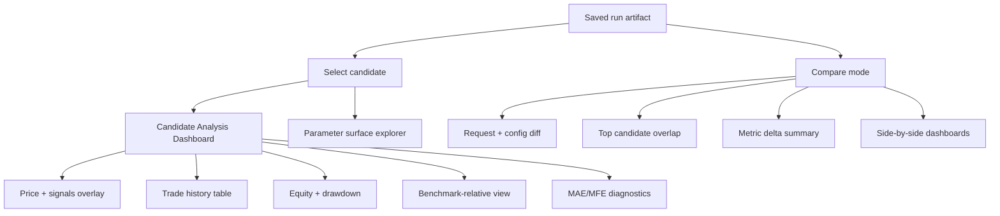
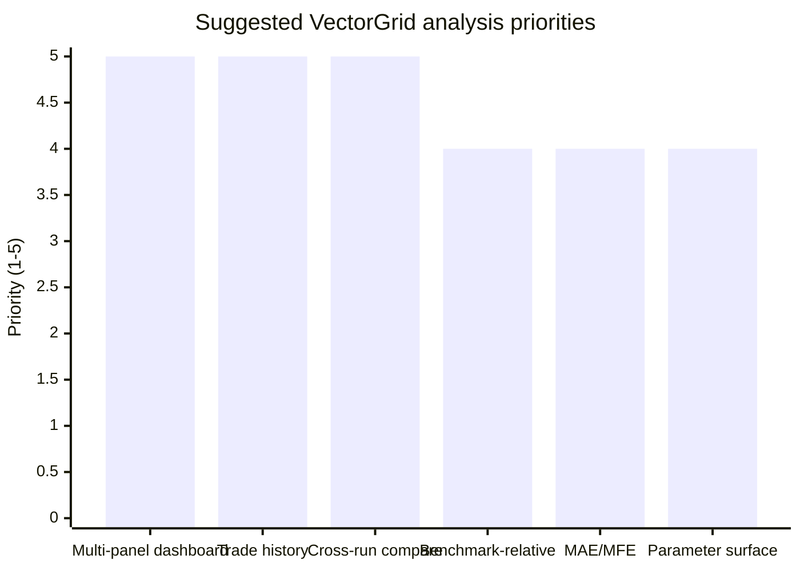

# Deep research on Question 15 in VECTORGRID_DEEP_RESEARCH_QUESTION_PACK_2026-04-09.md

## Executive summary

VectorGrid’s biggest “analysis and visualization parity” opportunity versus mature quant research tools is not adding more strategy logic; it is making existing results *inspectable, comparable, and explainable* inside the desktop workflow. This aligns with the repo’s own competitive framing that visualization depth and exploratory analysis are major gaps and high-leverage improvements. fileciteturn0file6 fileciteturn0file7

In mature tools, the highest-impact analysis capabilities cluster into a few patterns: interactive multi-panel result dashboards (equity/drawdown/returns + linked zoom), trade-history inspection with drill-through (orders → trades → positions), benchmark-relative performance views (alpha/beta/tracking error/information ratio and “vs benchmark” curves), and trade-quality diagnostics such as MAE/MFE (maximum adverse/favorable excursion) and “how trades evolve” plots. These are explicitly productized in VectorBT PRO’s analysis surface, and analogous multi-panel result inspection exists in platforms like QuantConnect’s backtest results UI and research environment. citeturn8view0turn1view2turn1view3

For VectorGrid specifically, the best-fit approach is an **additive “Candidate Analysis Dashboard + Compare Mode”** that reuses existing artifacts and tables (Top/Heatmap/Drill/Validation) rather than replacing workflows. The smallest valuable slice is: (1) a human-readable trade table with linked highlights on the price chart, (2) benchmark-relative curves and a small set of benchmark-dependent metrics, (3) MAE/MFE distributions and scatterplots, and (4) a run-to-run visual diff that answers “what changed, and what outcome changed” without exporting to XLSX. citeturn8view0turn7view0turn5view2turn1view2

A key reason this matters: large-scale optimizer searches amplify selection bias and backtest overfitting risk; analysis surfaces that emphasize robustness, distributional outcomes, and benchmark-relative behavior reduce the chance users “trust a number” without seeing instability or fragility. citeturn9view1turn9view0

## Extracted text of question 15

> Which analysis and visualization capabilities in mature tools like VectorBT most materially improve research productivity, candidate inspection, and trust, and which of those would translate well into VectorGrid's desktop workflow? Focus on trade-history inspection, benchmark-relative views, MAE/MFE-style diagnostics, parameter-surface exploration, multi-panel candidate analysis, and cross-run visual comparison. Distinguish high-value parity targets from notebook-native or overly open-ended capabilities that VectorGrid should not imitate. Prefer additive analysis surfaces that enrich current result workflows rather than replacing them. fileciteturn0file1

## What authoritative tools show as “high-leverage” analysis

VectorGrid’s stated product context is a **local-first Windows-first Tauri desktop app** (Vue frontend + Rust backend, optional CUDA paths) that prioritizes reproducible workflows and does **not** aim to become an unrestricted Python “strategy engine.” fileciteturn0file1 fileciteturn0file5 This matters because many analysis advantages in Python tooling come from notebook-native composability; VectorGrid needs *productized* equivalents.

### VectorBT’s core model: “records + metrics + plots” at scale

VectorBT centers analysis around sparse event “records” (orders, trades, drawdowns, positions) to avoid dense matrix conversion and enable large-scale evaluation. citeturn0search11 Trades are explicitly defined as sequences of orders with PnL attached and support aggregation (e.g., trades → positions). citeturn1view0

VectorBT’s plotting layer is designed for interactive visualization in Jupyter via Plotly figure widgets (ipywidgets-compatible). citeturn3view0 That specific notebook/UI integration is not directly portable to VectorGrid, but the abstract pattern—**standard plots with consistent semantics + interactive selection/zoom + drill-through from summary → event records**—is portable.

### VectorBT PRO’s productized analysis features map directly to the question’s focus areas

VectorBT PRO’s Analysis surface explicitly includes the exact categories in DR-15:

- **Trade history** as a human-readable DataFrame “listing orders” and extended with entry/exit/position details. citeturn8view0  
- **Trade signals plotting** that separates long/short entries/exits, supporting clearer interpretation of directionality and signal timing. citeturn8view0  
- **MAE/MFE diagnostics**, including plots for MAE returns and discussion of how MAE (max loss during a trade) and MFE (max profit reached) inform exit strategy evaluation. citeturn8view1  
- **Expanding trade metrics**, explicitly motivated by the limitation that single MAE/MFE summarizes only a final point; VectorBT PRO adds views of how such metrics “develop during the trade.” citeturn8view0  
- **Benchmark-relative analysis**, including a first-class benchmark setting and cumulative returns comparison (example: compare one asset to a benchmark index). citeturn8view1

These sources are particularly valuable because they show which analysis capabilities a mature tool decided to **productize** (not merely make possible via code). citeturn8view0turn8view1

### Benchmark-relative “trust” views are standard in mature backtest UIs, not only notebooks

In entity["company","QuantConnect","algorithmic trading platform"], the backtest results page presents equity curve, trades, logs, and performance statistics, and supports interactive chart manipulation (toggle series, linked zoom periods, resizing, moving charts). citeturn1view2 This is an important precedent for VectorGrid because it demonstrates a desktop-like, product UI approach to multi-panel backtest inspection (as opposed to notebook composition). citeturn1view2

QuantConnect’s result statistics include benchmark-relative concepts such as Beta, Alpha, Tracking Error, and Information Ratio in its “Overall Statistics” list—illustrating that benchmark-relative interpretation is considered “core” for strategy evaluation and communication. citeturn1view2

QuantConnect also describes a research workflow in which backtest results can be loaded into a research environment to analyze trades and compare backtests (including searching for high churn periods to reduce turnover/fees), which is highly aligned with VectorGrid’s need for cross-run comparison and operator trust. citeturn1view3

image_group{"layout":"carousel","aspect_ratio":"16:9","query":["VectorBT Pro trade history table screenshot","VectorBT heatmap plotly example","QuantConnect backtest results interface equity curve trades statistics"],"num_per_query":1}

## What “analysis parity” should mean for VectorGrid

VectorGrid already has a workflow shell and result surfaces (including tables and heatmaps) and treats visualization/analysis depth as a key competitive gap—so DR-15 is about **turning existing computation into higher trust and faster iteration**, not about adding more compute. fileciteturn0file6 fileciteturn0file7 fileciteturn0file0

A defensible definition of “analysis parity that matters” (for VectorGrid’s constraints) is:

- **Faster falsification:** quickly identify why a top-ranked candidate is likely fragile (overfit regime-dependence, concentration of returns, poor trade distribution, excessive churn). This reduces wasted optimization cycles and reduces the chance of false confidence. citeturn9view1  
- **Traceability:** for any candidate, answer “what trades happened, when, why (signals), under what route/backtest assumptions, and how do those trades aggregate into equity.” This mirrors the “records + drill-through” model. citeturn0search11turn1view0turn8view0  
- **Comparability:** answer “what changed between run A and run B, and what changed in outcomes,” without exporting to external tools. citeturn1view3  
- **Benchmark context:** show how performance relates to a baseline (buy-and-hold, index, or a chosen benchmark returns series), because absolute returns alone are routinely misleading. citeturn1view2turn7view0turn5view2turn8view1

This is consistent with robust backtest evaluation concerns: large searches (exact-grid, many parameter combinations) raise selection bias risk. Bailey & López de Prado’s work argues that without controlling for multiple testing and backtest overfitting, reported backtests can be misleading; they emphasize diagnostics like PBO (probability of backtest overfitting) and corrections like DSR (deflated Sharpe ratio). citeturn9view1turn9view0 Even though DR-15 is about analysis/visualization, these papers support why *distributional and robustness-focused analysis surfaces* matter in optimizer-driven products.

## Recommended parity targets that translate well into VectorGrid

This section prioritizes features by (a) impact on productivity/trust and (b) fit with a desktop, local-first, guardrailed workflow (i.e., no notebook-native “build anything” paradigm). fileciteturn0file1

### High-value targets

Trade-history inspection is a repeated theme across mature tools because it closes the gap between “metric score” and “what actually happened.” VectorBT PRO explicitly elevates trade history as a first-class object. citeturn8view0 VectorBT’s underlying model of trades as order sequences supports drill-through and aggregation. citeturn1view0

Benchmark-relative views are similarly central: VectorBT supports benchmark returns in its returns accessor and warns when benchmark-dependent metrics are missing, explicitly tying metrics like benchmark return/alpha/beta to the availability of benchmark returns. citeturn7view0turn5view2 VectorBT PRO also productizes benchmark setting and cumulative return comparison. citeturn8view1 QuantConnect includes alpha/beta/tracking error/information ratio among key statistics. citeturn1view2

MAE/MFE-style diagnostics have strong practical value for exit/stop design because they answer: “How bad did it get before it worked?” and “How much profit was available vs realized?” VectorBT PRO productizes MAE/MFE plots and even expands into “expanding trade metrics” to show the path of trade quality through time. citeturn8view1turn8view0

Parameter-surface exploration is valuable when an optimizer produces many candidates: it helps identify **broad plateaus vs sharp peaks** (a common proxy for fragility). In VectorBT’s ecosystem, heatmap-style visualization of grid search results is a common workflow pattern (and VectorBT contains a plotting Heatmap primitive). citeturn3view0

Multi-panel candidate analysis is a pragmatic UI packaging choice: QuantConnect’s results UI shows that multi-panel chart dashboards with linked manipulation (zoom, toggle series) can be productized and used for investigation. citeturn1view2

Cross-run visual comparison aligns closely with QuantConnect’s stated goal of comparing backtests to find uncorrelated strategies and analyzing churn/fees drivers. citeturn1view3 In VectorGrid’s own competitive roadmap, compare and richer analysis UX is a major stated parity target area. fileciteturn0file6 fileciteturn0file7

### Targets that should be treated cautiously or intentionally out of scope

VectorBT PRO’s more open-ended mechanisms (for example, deep callback-driven simulation and broader notebook-native composition) are powerful but clash with VectorGrid’s stated philosophy of constrained, reproducible, guardrailed workflows rather than becoming a notebook platform. fileciteturn0file1 citeturn0search8

Similarly, VectorBT PRO’s “patterns and projections” analysis family is compelling, but it is closer to a generalized event-study / pattern-mining subsystem. It may be valuable, but it is harder to scope tightly and easier to turn into an open-ended research feature surface. citeturn8view1 For VectorGrid, this should be treated as a *later* or *research-only* extension unless it can be constrained to a small number of auditably-defined projections tied to existing workflows.

## Implementation shape for VectorGrid

This is intentionally framed as **additive UI + artifact enrichment** rather than workflow replacement, consistent with the repo’s “preserve existing workflows by default” posture. fileciteturn0file3 fileciteturn0file6

### Feature-to-slice mapping

| Capability | Why it matters (productivity / trust) | External precedent | Best-fit VectorGrid slice (additive) |
|---|---|---|---|
| Trade history table + drill-through | Turns metrics into auditable “what happened”; enables churn and fee diagnosis | VectorBT PRO trade history; QuantConnect trades tab | “Trade Inspector” panel: sortable/filterable trade table + click-to-highlight on chart + export subset |
| Trade signals overlay | Makes entry/exit timing and direction obvious; reduces misinterpretation | VectorBT PRO trade signals | Price chart overlay for long/short entry/exit markers + legend toggles |
| Benchmark-relative metrics + curves | Prevents misleading absolute-return interpretation; supports communication | VectorBT benchmark returns/alpha/beta; QuantConnect alpha/beta/tracking error/IR | “Benchmark” selector (buy-and-hold of same symbol by default) + relative equity curve + alpha/beta/IR/TE summary |
| MAE/MFE diagnostics | Improves stop/exit reasoning; identifies “pain before profit” and missed run-up | VectorBT PRO MAE/MFE + expanding trade metrics | Per-trade MAE/MFE distributions + scatter MAE vs MFE + optional time-to-MFE histogram |
| Parameter surface exploration | Differentiates plateau vs spike; supports robust region selection | VectorBT plotting Heatmap; common VectorBT optimization workflow | Interactive heatmap with crosshair + 1D slices on hover + “stability region” highlighting heuristics |
| Multi-panel candidate dashboard | Reduces context switching; supports linked reasoning | QuantConnect multi-chart UI | Single dashboard: price+signals, equity, drawdown, trade distribution, rolling metric |
| Cross-run compare | Answers “why did this change?” quickly; enables experiment intelligence | QuantConnect compare backtests concept | Compare two artifacts: request diff + metric deltas + candidate overlap + side-by-side dashboard panels |

All “external precedent” cells above are grounded in official product/docs pages for VectorBT/VectorBT PRO and QuantConnect. citeturn8view0turn8view1turn1view2turn1view3turn7view0turn3view0

### Suggested UI architecture using existing workflow surfaces

This diagram reflects the productized “dashboard + drill-through + compare” patterns documented in mature tools. citeturn1view2turn1view3turn8view0turn8view1

### Priority chart

The following is a *product judgment* priority ordering (not an externally standardized measurement), but it is consistent with which features are emphasized as first-class in authoritative tool docs. citeturn8view0turn8view1turn1view2turn1view3

## Assumptions, limitations, and recommended next steps

### Assumptions

This answer assumes VectorGrid already has (or can readily derive) trade/position events and equity curves for candidates, since mature analysis features in VectorBT/QuantConnect depend on such event records. citeturn1view0turn0search11turn1view2 It also assumes VectorGrid’s artifact-first workflow is the correct integration point for adding inspection and compare surfaces, which matches the repo’s emphasis on local-first artifacts, reports, and workflow preservation. fileciteturn0file3 fileciteturn0file6

### Limitations

Some high-value analysis patterns in VectorBT are tightly coupled to notebook-native interactivity (Plotly + ipywidgets). VectorBT’s plotting docs explicitly target interactive Jupyter environments, so VectorGrid must implement equivalent interactions via its own charting stack rather than attempting a direct port. citeturn3view0

Also, while robustness/overfitting literature supports adding clearer diagnostics, it does not uniquely prescribe UI design. Translating concepts like PBO/DSR into a desktop UX requires local product judgment and local usability testing to avoid overwhelming users or implying false certainty. citeturn9view0turn9view1

### Recommended next steps

First, enumerate what data already exists in saved artifacts and in the analysis/drilldown surfaces, then map it onto a “Candidate Analysis Dashboard” payload contract so the UI can become richer without re-running computations. This aligns with the repo’s emphasis on additive changes and workflow preservation. fileciteturn0file3 fileciteturn0file7

Second, implement a **Trade Inspector v1**: a human-readable trade table with linked brushing to the price chart (click a trade row → highlight entry/exit markers and the trade interval). This is directly supported by VectorBT PRO’s explicit treatment of trade history as a core analysis tool and QuantConnect’s trade tab drill-through model. citeturn8view0turn1view2

Third, add **benchmark-relative defaults**: start with “buy-and-hold of the same instrument” as the default benchmark and allow an optional benchmark series selection. The value of benchmark-dependent metrics (benchmark return/alpha/beta) is explicit in VectorBT’s returns accessor (including warnings when benchmark data is missing) and in QuantConnect’s key-statistics framing. citeturn7view0turn1view2turn8view1turn5view2

Fourth, add **MAE/MFE diagnostics** in a constrained, credible way: implement per-trade MAE/MFE (and optionally “expanding” versions) and visualize distributions/scatterplots; keep wording clear that these rely on bar-level high/low data and that intrabar path is not fully observed unless the system uses more granular data. VectorBT PRO’s “OHLC-native classes” and MAE/MFE pages make this dependency explicit by emphasizing OHLC-aware analysis. citeturn8view1

Fifth, implement a **Compare Mode v1** over two saved runs: request/config diff + outcome deltas + top-candidate overlap + side-by-side candidate dashboards. This aligns with QuantConnect’s explicit “compare backtests” research workflow and with VectorGrid’s own roadmap emphasis on compare and richer analysis UX. citeturn1view3 fileciteturn0file6 fileciteturn0file7

## Prioritized sources

VectorBT PRO “Analysis” feature documentation (trade history, trade signals, MAE/MFE, expanding trade metrics, benchmark setting) is the single best primary source for what a mature productized analysis surface looks like in a VectorBT-adjacent ecosystem. citeturn8view0turn8view1

VectorBT official documentation on trades, records, and plotting provides the underlying conceptual model (records-based event analysis; interactive plotting approach) that explains why these analysis capabilities scale. citeturn1view0turn0search11turn3view0

QuantConnect documentation on backtest results and backtest analysis provides an authoritative example of multi-panel, interactive result inspection and cross-backtest comparison in a non-notebook product UI. citeturn1view2turn1view3

Bailey & López de Prado’s papers on backtest overfitting and performance inflation (PBO/CSCV, DSR) ground why optimizer-driven workflows particularly benefit from distributional/robustness-oriented analysis and careful confidence framing. citeturn9view0turn9view1

VectorGrid repo documents (question pack + competitive improvement plan + parity roadmap + repo map + architecture notes) establish the product constraints (local-first, guardrailed desktop workflow, preserve existing workflows) and confirm that analysis/visualization depth is a top competitive gap worth closing via additive surfaces. fileciteturn0file1 fileciteturn0file6 fileciteturn0file7 fileciteturn0file0 fileciteturn0file3