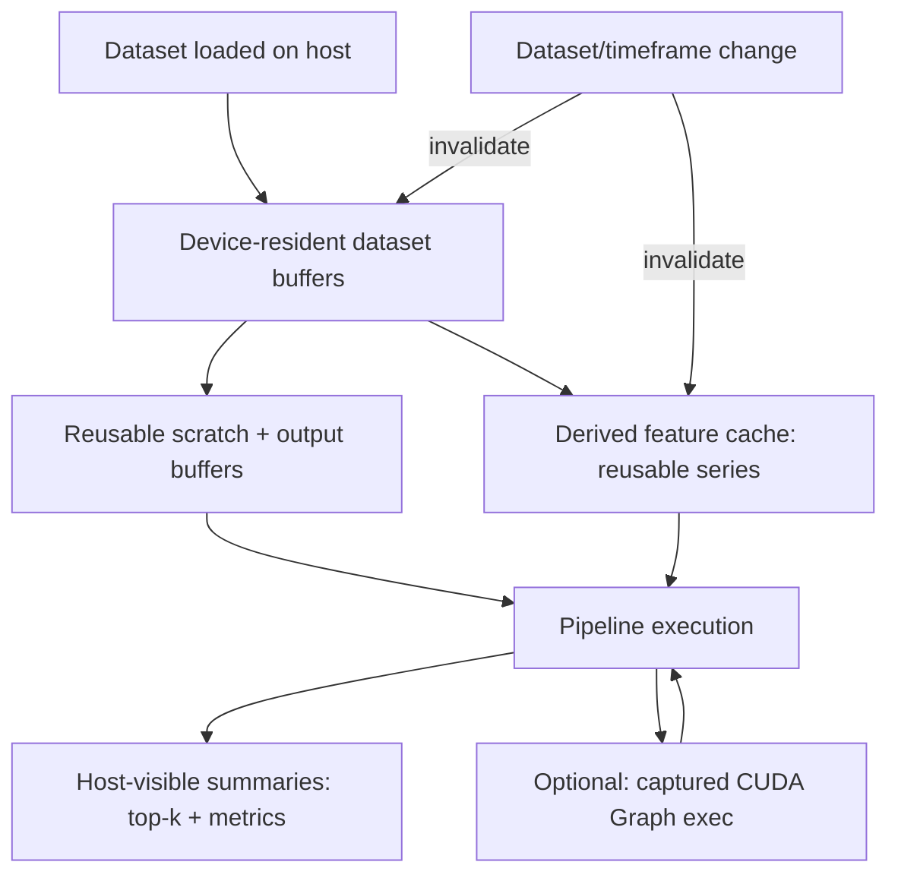

# GPU Runtime Architecture Patterns for Repeated Optimization and Validation

## Executive summary

The file **`VECTORGRID_DEEP_RESEARCH_QUESTION_PACK_2026-04-09.md`** was **not discoverable on the public web** via exact-filename search, quoted-title search, or GitHub-focused queries; results were dominated by an unrelated project named “VectorGrid” (the Leaflet vector-tiling plugin), which strongly suggests your VectorGrid question pack is **private/internal** or otherwise not indexed publicly. citeturn1search0

Because the question pack **was available as an uploaded local file** in this session (path shown in the prompt metadata), I was able to **locate the sixth question inside the file** and answer it directly. The sixth question is **DR-06**, which asks for **2024–2026** architecture patterns for a **Rust + CUDA** engine that repeatedly reuses the same dataset in memory/VRAM, comparing **per-indicator kernels, fused kernels, staged device graphs (CUDA Graphs), caller-owned device output buffers, and runtime cache reuse strategies**.

The most externally mature and transferable patterns for this workload family are: (a) **treat repeated runs as a “steady-state pipeline”** and pay setup costs once, (b) use **CUDA Graphs** to amortize CPU-side launch overhead across repeated iterations (including parameter updates and stream-capture patterns), (c) use **stream-ordered allocation / memory pools** (`cudaMallocAsync`/`cudaFreeAsync`) to avoid synchronization-heavy alloc/free churn, (d) prioritize **global-memory efficiency** (coalescing, bandwidth saturation) and use **fusion** when it reduces memory traffic materially, and (e) base decisions on profiling + a simple performance model (e.g., Roofline) because the “right” split between fusion vs staging is often application-specific. citeturn6view0turn15view0turn6view1turn9view0turn14view0turn12view1

## Locating the question pack file

Public-web discovery attempts were run against: (1) the **exact filename** in quotes, (2) quoted fragments like “VectorGrid Deep Research Question Pack” with the date, and (3) GitHub-targeted queries containing “VECTORGRID_DEEP_RESEARCH_QUESTION_PACK”. No public matches were returned for the exact filename; searches for “VectorGrid” heavily surfaced an unrelated GitHub repository (**Leaflet.VectorGrid**) because that name is already established and well-indexed. citeturn1search0

Because the pack was **not found online**, the practical ways to obtain/verify it externally are procedural rather than technical:
- Request access to the repository or document store where your VectorGrid research folder lives (private Git host, internal monorepo, shared drive).
- Ask a maintainer to provide a **public permalink** (e.g., a Git commit hash + path) or to publish a redacted copy if the content is meant to be shareable.
- If it is in a Git repository, run `git ls-files | grep VECTORGRID_DEEP_RESEARCH_QUESTION_PACK` and then `git log --follow -- <path>` to verify filename history and the “2026-04-09” date against commit metadata.

In this session, the file **was available locally** (the uploaded-file mount referenced in your prompt metadata). The file content begins with the title “VectorGrid Deep Research Question Pack” and an internal “Date: 2026-04-09” header, which matches the filename suffix. (Local file; no public URL available.)

## The sixth question and its context

Within the question pack, prompts are enumerated as **DR-01** through **DR-15** in order; the **sixth** item in that ordered list is:

> `Survey the best 2024-2026 architecture patterns for GPU-accelerated indicator sweeps and backtests when repeated runs reuse the same dataset. For a Rust + CUDA engine with warm in-memory and VRAM-resident execution paths, compare per-indicator kernels, fused kernels, staged device graphs, caller-owned device output buffers, and runtime cache reuse strategies. Recommend only the externally mature patterns that are realistic to borrow into VectorGrid, and explicitly separate those from ideas that are likely too repo-specific to answer without local profiling.`  
(Local file; extracted verbatim.)

Context immediately preceding the questions includes a “project context” block describing a **Windows-first Tauri desktop app** with a **Rust backend**, **optional CUDA**, and a focus on **GPU-aware exact-grid optimization/validation**, **local-first artifacts**, **route/fallback transparency**, and **CPU-only support when CUDA is unavailable** (local file). The pack also tags DR-06 as “use selectively,” indicating that **local repo evidence/profiling** should dominate parts of the answer (local file).

A key repo-grounding detail relevant to DR-06 (from your local repo map) is that your system already distinguishes a “pure VRAM route” for a hot path (Double-MA) and notes a gap where a more generic indicator path does not borrow already-resident buffers—exactly the sort of “cache reuse strategy” DR-06 is pushing toward evaluating (local file evidence; no public URL available).

## Evidence base and primary sources

The most authoritative external sources for “staged device graphs,” allocator behavior, and kernel scheduling are the official entity["company","NVIDIA","gpu company"] CUDA documentation and technical blogs.

CUDA Graphs are explicitly designed to amortize per-kernel CPU/driver launch overhead by capturing a workflow once, instantiating it, and then launching the instantiated graph repeatedly with low overhead—especially valuable when kernels are short and launched many times. citeturn6view0turn8view2 They are represented as node/edge DAGs, where nodes can include kernels, memcpy/memset, events, conditional nodes, and nested graphs. citeturn6view0 CUDA also documents two update mechanisms—whole-graph update and individual node parameter updates—intended for cases where the **workflow structure is stable** but **parameters change between launches**, which aligns closely with repeated optimization/validation loops. citeturn15view0turn8view1 Stream capture is presented as a practical construction mechanism (including capturing library calls), while also documenting prohibited operations and invalidation pitfalls during capture. citeturn15view2

For allocation churn and scratch-buffer lifetimes, CUDA’s stream-ordered allocator (`cudaMallocAsync`, `cudaFreeAsync`) and memory pools are now the first-class documented approach for reducing synchronization and allocation overhead, reusing blocks, and limiting fragmentation in frequent-alloc scenarios. citeturn6view1turn6view2

For “per-indicator kernels vs fused kernels,” the governing external reality is typically **memory traffic**. CUDA performance guidance repeatedly emphasizes that efficient global-memory access (especially coalesced access patterns) is critical, and strided/uncoalesced patterns can dramatically increase the number of memory transactions required. citeturn9view0turn11view0 NVIDIA training material and best-practice guidance likewise emphasizes using shared memory (where applicable) to reduce global memory traffic and avoid pathological access patterns. citeturn13view0turn11view0

For a rigorous “why,” the Roofline model remains a standard way to justify whether you should prioritize reducing memory traffic (increasing operational intensity) versus trying to increase raw compute throughput. Its canonical bound is:

> Attainable performance = min(peak FLOP/s, peak bandwidth × operational intensity) citeturn14view0

Finally, for *recent* literature on CUDA Graphs in iterative workloads, a 2025 paper by entity["people","Jonah Ekelund","cuda graphs paper author"] et al. describes and models kernel batching/unrolling into CUDA Graphs, reporting meaningful speedups in scenarios dominated by many fine-grained launches—while also emphasizing the trade-off vs graph creation overhead and graph-size limits. citeturn12view1

## Answer to the sixth question

This section answers DR-06 directly: it compares the named architectural approaches, recommends externally mature patterns that are realistic to borrow into a Rust+CUDA “warm VRAM” engine, and explicitly distinguishes what is likely repo-specific without profiling.

### Setup: what “repeated runs reuse the same dataset” implies

A repeated-run optimizer/validator has two very different operating regimes:

1) **Cold start**: dataset load, parsing, CPU preprocessing, initial upload(s), JIT compilation (if any), first-use cache fill.  
2) **Steady state**: repeated parameter sweeps / validations where the dataset is constant and only *parameters* or *candidate selections* change.

DR-06 is fundamentally about making the **steady state** extremely fast and stable. In steady state, the dominant primitives are:
- keeping base series resident (host memory and/or device memory),
- reusing allocations and scratch buffers,
- minimizing CPU-side launch overhead for repeated micro-work,
- keeping memory traffic coalesced and bounded,
- returning *summaries* (top-k, aggregates) rather than copying large matrices back to host.

A simple time model for one “run” (one optimization or validation pass) is:

\[
T_{\text{run}} \approx T_{\text{dispatch}} + T_{\text{compute}} + T_{\text{mem}} + T_{\text{reduce}} + T_{\text{copyout}}
\]

In many “many small kernels” pipelines, \(T_{\text{dispatch}}\) (CPU/driver overhead per launch) becomes non-trivial; CUDA Graphs exist specifically to reduce this term by paying setup once and relaunching cheaply. citeturn6view0turn8view2turn12view1

### Per-indicator kernels

**Definition.** Each indicator (and often each parameterization) is computed via its own kernel (or a small set of kernels), producing an output series (or partials) that downstream kernels consume.

**Advantages.**
- Modularity: easy to add indicators, compose pipelines, and debug.
- Reuse potential: if multiple strategies consume the same intermediate (e.g., returns, ATR, rolling mean), it can be computed once and cached.

**Costs and failure modes.**
- **Kernel launch overhead** grows with the number of small kernels; if kernels are short, overhead can be a large fraction of end-to-end time. CUDA’s guide explicitly calls out this regime and frames graphs as the remedy for “workflows launched many times” to amortize launch-cost setup. citeturn6view0turn8view2turn12view1
- **Memory traffic explosion** if each stage materializes full-length arrays, especially if multiple parameterizations are realized as separate outputs.
- **VRAM pressure**: materializing series for many parameter points is often combinatorially large. (In practice you must tile, stream, or avoid full materialization.)

**When this is externally “mature” and worth using.**
- When indicator output is reused across multiple downstream computations (high cache hit rate).
- When kernels are heavy enough (or batched enough) that launch overhead is not the bottleneck.
- When the pipeline graph is stable enough that you can capture it via CUDA Graphs (see “staged device graphs” below).

### Fused kernels

**Definition.** Combine multiple logical stages (indicator compute + decision logic + PnL update/reduction) into fewer kernels—sometimes a single kernel for the hottest path—so that intermediate arrays are not written to and read from global memory.

**Why fusion is often the right instinct for backtests.**
Backtests that update a small state per candidate per bar are frequently **memory-traffic limited**: reading price/candle data and writing minimal per-candidate state. The roofline bound makes the core argument: if your operational intensity is low, your achievable performance is bounded by bandwidth; reducing global memory traffic (by avoiding intermediate writes/reads) can move you upward more than “more math” can. citeturn14view0turn9view0

**Advantages.**
- Fewer global memory round-trips (and often fewer kernels): tends to improve bandwidth efficiency and reduce launch overhead simultaneously.
- Avoids storing full intermediate series when only the final trading decision is needed.
- Can be shaped to write out only summaries (e.g., metrics + top-k indices), minimizing host/device transfer.

**Costs and failure modes.**
- Reduced flexibility: adding an indicator may require kernel changes.
- More complex kernels can increase register pressure, reduce occupancy, or create divergent control flow; profiling is required (fusion is not automatically faster).
- Fusion opportunities depend on indicator math (some indicators are naturally streaming; others require windowed state that may or may not fuse cleanly).

**Externally mature guidance for making fusion work.**
- Treat memory access patterns as first-class: coalesced access and minimizing strided patterns are repeatedly emphasized in CUDA performance guidance. citeturn9view0turn11view0
- Where shared memory buffering is applicable, it is widely taught as a way to reduce global memory traffic, but it introduces its own constraints (bank conflicts, occupancy), so it must be measured. citeturn13view0turn11view0

**Rule of thumb for VectorGrid-like engines.**
- Keep “single-purpose per-indicator kernels” for **feature-series reuse** and for “heavy” indicators where kernel time dwarfs launch overhead.
- Use “fused backtest kernels” for the **dominant throughput path** where intermediates would otherwise flood VRAM/memory bandwidth.

### Staged device graphs

**Interpretation.** In CUDA’s ecosystem, the externally standardized and mature “device graph” concept is **CUDA Graphs**: a captured or explicitly constructed DAG of operations that can be instantiated and relaunched. CUDA’s guide defines graphs as nodes (kernels, memcpy/memset, host functions, events, conditional nodes, child graphs) plus dependency edges. citeturn6view0

**Why this matters for indicator+backtest pipelines.**
If your architecture uses multiple stages (indicator chain → signal logic → backtest → reductions → copy-out), and you repeat it across many runs on the same dataset, then:
- Graph instantiation cost can be amortized.
- Graph launch can replace many per-kernel launches, directly targeting dispatch overhead. citeturn6view0turn8view2turn12view1

**Two mature construction patterns.**
- **Stream capture**: bracket existing stream-based code between `cudaStreamBeginCapture` / `cudaStreamEndCapture` and obtain a graph (including library calls). CUDA documents the semantics and cross-stream dependency handling via events. citeturn15view2turn6view0
- **Explicit graph API**: manually construct graph nodes/edges; this gives control but is more code.

**Parameter variability without re-capturing everything.**
CUDA documents two update mechanisms:
- whole-graph update (`cudaGraphExecUpdate`) with a topologically identical graph, and
- individual node parameter updates for a small number of changes. citeturn15view0turn8view1

This is directly applicable to repeated optimization/validation where:
- the dataset buffers are fixed,
- the pipeline topology (kernels and dependencies) is stable,
- but kernel parameters (periods, thresholds, stride sizes, pointers to parameter blocks) vary between runs.

**Limitations that are externally documented (and operationally important).**
Stream capture has prohibited operations (e.g., synchronizing/querying captured streams) and can invalidate captures if invalid operations occur; CUDA explicitly documents these pitfalls. citeturn15view2 Also, the 2025 kernel-batching paper emphasizes that graph creation overhead and memory footprint can become substantial if graphs are too large; there is typically an optimal batching granularity rather than “one graph node per micro-step forever.” citeturn12view1

### Caller-owned device output buffers

**Definition.** The caller (your runtime) allocates output buffers once and passes device pointers into kernels, rather than letting each indicator/backtest invocation allocate its own outputs.

**Why it is the “default right answer” for steady-state reuse.**
- Lets you reuse allocations across runs (or even across different pipelines) and control lifetimes explicitly.
- Enables memory pooling and stream-ordered allocators to be centralized in a “GPU runtime” layer rather than scattered across indicator implementations.

**External maturity.**
This is a general CUDA design norm: kernels operate on pointers provided by the caller; what’s become more “officially optimized” recently is the allocator side—stream-ordered allocation APIs and memory pools that are designed specifically to reduce overhead and avoid synchronization. citeturn6view1turn6view2  
The key point for a repeated-run engine is that allocations should not happen in the inner loop when you can reuse buffers or allocate from a pool.

**How it composes with CUDA Graphs.**
CUDA Graphs are easiest to reuse when memory addresses are stable across graph launches. Centralizing allocation and reusing buffers increases the chance that you can keep pointer stability while only updating scalar parameters or pointer-to-parameter blocks via node updates. citeturn15view0turn8view1

### Runtime cache reuse strategies

For a VRAM-resident “warm dataset” engine, cache reuse is not one cache—it is a stack of caches with different invalidation rules. A robust, externally-aligned design is to make these *explicit layers*:

**Layer 1: device-resident dataset buffers.**  
Keep the canonical candle/price arrays in device memory once and reuse. This eliminates repeated H2D transfers, and it also creates a stable base address space for graph capture/replay. The CUDA best practices guide describes how streams can overlap transfers and compute and notes pinned host memory requirements for meaningful overlap; but for repeated runs, the better strategy is usually to avoid transfers entirely by keeping data resident. citeturn11view2

**Layer 2: derived feature cache.**  
Cache only what is reused enough to justify its VRAM footprint (e.g., log returns, typical price, or a small set of broadly reused transforms). The rule is: cache when it materially reduces repeated compute *and* you can bound memory usage and invalidation complexity.

**Layer 3: scratch/output buffer arena.**  
Allocate once (or allocate from a pool) and reuse across runs. Use CUDA’s stream-ordered allocator and pools when you truly need dynamic allocation without expensive synchronization. citeturn6view1turn6view2

**Layer 4: pipeline/graph cache.**  
If a pipeline topology repeats (same indicator DAG, same reduction steps), cache either:
- an instantiated CUDA Graph exec object (best when stable), or
- a compiled “plan” object that can regenerate/update graphs.

CUDA explicitly supports updating instantiated graphs and individual nodes, which can be used to reflect changing parameter blocks run-to-run without full re-instantiation. citeturn15view0turn8view1

**Layer 5: host-visible results cache (optional).**  
Cache top-k results, summary metrics, and “explanations” keyed by a stable hashing of dataset identity + pipeline + parameters. This is a product/UX decision as much as a compute decision; it dramatically affects perceived responsiveness.

### The externally mature recommendations that are realistic to borrow into VectorGrid

These are the patterns whose *external maturity* is strong enough that adopting them is usually justified before inventing novel runtime machinery:

1) **Adopt CUDA Graphs selectively for multi-kernel steady-state pipelines**, especially where you currently run many fine-grained kernels repeatedly. CUDA itself describes graphs as the mechanism to amortize per-launch overhead for workflows launched many times, and recent literature shows meaningful speedups for iterative fine-grained launch patterns while emphasizing a graph-size trade-off. citeturn6view0turn12view1turn8view2

2) **Use stream capture + graph/node update where parameters change but topology does not.** CUDA documents stream capture mechanics and explicitly documents whole-graph update and individual node updates for instantiated graphs, which aligns with “same pipeline, new parameters” workloads. citeturn15view2turn15view0turn8view1

3) **Standardize on buffer reuse and memory pools for inner-loop allocations.** CUDA’s stream-ordered allocator docs explain that memory pools manage/reuse blocks to reduce overhead and fragmentation, and `cudaMallocAsync`/`cudaFreeAsync` avoid expensive synchronization points typical of naive alloc/free usage. citeturn6view1turn6view2

4) **Treat memory traffic as the first-order constraint for indicator sweeps and backtests.** CUDA guidance repeatedly stresses the importance of coalesced access and warns that strided/uncoalesced patterns inflate transactions. This is the fundamental reason fusion can help: fusion reduces global-memory round trips. citeturn9view0turn11view0turn13view0

5) **Use a simple bound model (Roofline) to decide where to invest.** The Roofline bound (“min of peak FLOP/s vs bandwidth×intensity”) is a rigorous way to distinguish “you need fusion / less memory traffic” from “you need more parallelism / occupancy / better instruction throughput.” citeturn14view0

### Ideas that are plausible but likely too repo-specific without local profiling

These ideas can be excellent, but DR-06 explicitly asks to separate them because their payoff depends on your exact kernels, candidate sizes, and data shapes:

- **Aggressive auto-fusion / graph compilation** (beyond hand-fused hot kernels): tends to require either a compiler stack, heavy templating/JIT, or a dedicated DSL, and its real value depends on your indicator mix and how often reuse happens versus how often pipelines change.
- **Device-side dynamic scheduling of indicator DAGs** (beyond standard CUDA Graphs): newer CUDA Graph features such as conditional nodes can represent loops/branches in a graph (promising), but whether they map cleanly onto your “indicator sweeps + backtest” shape is a profiling and complexity question. citeturn6view4turn6view0
- **Multi-stream concurrent kernel execution for throughput**: CUDA supports overlapping and concurrent execution, but correctness constraints, batch sizes, and shared resource contention often dominate; the best practices guide emphasizes that streams can overlap copies/compute and sometimes concurrent kernels, but the right strategy depends on data dependency and device capabilities. citeturn11view2
- **Over-caching derived features in VRAM**: caching can backfire by evicting more valuable resident data, increasing L2/DRAM pressure, and complicating invalidation.

### Assumptions and limitations

This answer assumes a workload where (a) the dataset/timeframe stays constant across many runs, (b) you execute either many small kernels (indicator pipelines) or one/few large kernels (fused backtests), and (c) you can tolerate a “warmup” phase that constructs graphs/caches and then reuses them. If your workload is dominated by a single large kernel already (very fused), CUDA Graphs may offer limited benefit; if it is dominated by many micro-kernels, graphs and batching tend to be more valuable. citeturn6view0turn12view1

## Key references

| Title | Author | Year | URL |
| --- | --- | --- | --- |
| CUDA Programming Guide: CUDA Graphs | NVIDIA | 2026 | https://docs.nvidia.com/cuda/cuda-programming-guide/04-special-topics/cuda-graphs.html |
| CUDA Programming Guide: Stream-Ordered Memory Allocator | NVIDIA | 2026 | https://docs.nvidia.com/cuda/cuda-programming-guide/04-special-topics/stream-ordered-memory-allocation.html |
| CUDA Runtime API: Memory Pools | NVIDIA | 2026 | https://docs.nvidia.com/cuda/cuda-runtime-api/group__CUDART__MEMORY__POOLS.html |
| CUDA Runtime API: Graph Management | NVIDIA | 2026 | https://docs.nvidia.com/cuda/cuda-runtime-api/group__CUDART__GRAPH.html |
| CUDA C++ Best Practices Guide | NVIDIA | 2026 | https://docs.nvidia.com/cuda/cuda-c-best-practices-guide/ |
| Unlock GPU Performance: Global Memory Access in CUDA | NVIDIA | 2025 | https://developer.nvidia.com/blog/unlock-gpu-performance-global-memory-access-in-cuda/ |
| Dynamic Control Flow in CUDA Graphs with Conditional Nodes | NVIDIA | 2024 | https://developer.nvidia.com/blog/dynamic-control-flow-in-cuda-graphs-with-conditional-nodes/ |
| Constructing CUDA Graphs with Dynamic Parameters | NVIDIA | 2022 | https://developer.nvidia.com/blog/constructing-cuda-graphs-with-dynamic-parameters/ |
| Boosting Performance of Iterative Applications on GPUs: Kernel Batching with CUDA Graphs | Jonah Ekelund et al. | 2025 | https://arxiv.org/html/2501.09398v1 |
| Roofline: An Insightful Visual Performance Model for Floating-Point Programs and Multicore Architectures | entity["people","Samuel Williams","roofline model author"] et al. | 2009 | https://people.eecs.berkeley.edu/~kubitron/cs252/handouts/papers/RooflineVyNoYellow.pdf |