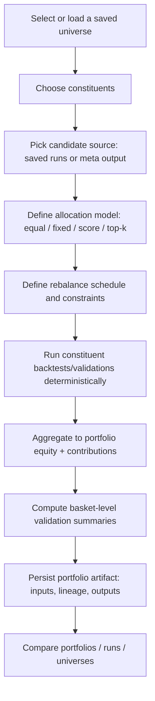

# Portfolio and basket research parity for VectorGrid

**Executive summary.** The third question in `VECTORGRID_DEEP_RESEARCH_QUESTION_PACK_2026-04-09.md` is **DR-03**, focused on defining the *smallest* first-class portfolio or basket research surface that materially improves competitiveness while staying compatible with a guardrailed desktop product. The file is **accessible** in the provided workspace, and the question is reproduced verbatim below (including punctuation and hyphenation). The highest-authority external anchors for answering DR-03 are (a) **VectorBT® PRO’s** own portfolio and data feature documentation—showing multi-asset simulation, grouping, cash sharing, and explicit asset-weighting primitives—and (b) **QuantConnect’s LEAN** portfolio construction model architecture—showing a clear decomposition between “alpha/insights” and “portfolio construction,” including equal-weight and score/confidence-weighted schemes with explicit rebalance frequency parameters. citeturn2search0turn2search13turn6search2turn6search3turn6search6  
A rigorous, VectorGrid-fit answer is: **treat “portfolio/basket” as an additive, declarative domain layer that sits on top of existing single-dataset workflows** (optimization/validation/meta/artifacts), rather than as a general multi-asset event-driven trading engine. The smallest first-class surface that still feels “real” is a **constrained portfolio-of-candidates + basket validation** workflow with: (1) a saved “basket/universe” object, (2) an allocation model limited to **equal-weight, fixed-weight, score-weighted, and top‑k** variants, and (3) portfolio-level summaries/visuals (equity, drawdown, contributions, turnover) derived from reproducible constituent runs. Equal-weight should be the default because simple 1/N allocation is often a strong out-of-sample baseline relative to estimation-heavy optimizers; optimized schemes are viable later but should not be the first required capability. citeturn0search0turn6search2turn2search0  
Recommended validation is staged: first validate **correctness and reproducibility** (weight normalization, calendar alignment, deterministic rebalance scheduling, artifact lineage), then validate **semantic parity** against VectorBT-style constructions on a shared benchmark basket, and only then optimize performance. citeturn2search0turn6search2turn6search3  

## Third question

**File status.** `VECTORGRID_DEEP_RESEARCH_QUESTION_PACK_2026-04-09.md` is present and readable in the provided file set.

**Third question exactly as written (DR-03).** (From lines 96–99 in the file.)

`What is the smallest first-class portfolio or basket-research surface that would materially improve VectorGrid's competitiveness with VectorBT while staying compatible with a guardrailed desktop product? Compare equal-weight, fixed-weight, score-weighted, and top-k portfolio models; basket-level validation; and multi-asset compare flows. Distinguish what should be treated as a real feature gap versus what is too broad or too open-ended for VectorGrid's current product philosophy. Prefer bounded additive surfaces that can coexist with current single-dataset workflows rather than replacing them.`

This question is explicitly framed by the pack’s project context (VectorGrid as a Windows-first Tauri desktop app; Rust backend with optional CUDA; local-first artifacts and reports; *not* an unrestricted Python engine). (From line 19 in the same file.)

## Interpretation and missing constraints

DR-03 is a product-and-architecture question disguised as a “portfolio math” question: it is asking for the **minimal product surface** that changes user capability in a high-leverage way, without breaking guardrails (local-first, reproducible, GPU-aware, non-arbitrary execution). In practice, “portfolio/basket research” can mean at least three distinct things, and DR-03 does not fully pin down which one is required:

**Basket evaluation (multi-asset robustness).** Apply the same candidate or strategy family across many symbols and summarize dispersion, pass rates, and regime sensitivity. This is closer to “cross-ticker validation,” but DR-03 implies a first-class UX and artifact representation.

**Portfolio simulation (combined equity).** Combine multiple assets (and possibly multiple strategies) into a single equity curve with explicit weights and rebalancing. This is what most users mean by “portfolio research,” and it is a major category in VectorBT-style workflows. citeturn2search13turn2search0  

**Multi-asset compare flows (analysis UX).** Visual comparisons across assets/strategies/portfolios (correlation, contributions, drawdown overlap, stress windows). DR-03 treats these as part of the “surface,” not just backend computation.

### Implicit assumptions baked into DR-03

DR-03 implicitly assumes:

- **A definition of “basket/universe” exists** (how assets are selected, named, stored, and reused). The internal roadmap already treats “saved universes” as a prerequisite foundation for portfolio workflows, implying the portfolio surface should not be built as ad hoc per-run lists. (See internal repo roadmap excerpts below.)  
- **A deterministic rebalance schedule exists** (even for “fixed weights,” the system must define when weights are applied—initial only, or periodically). This is explicit in LEAN portfolio construction models via rebalance frequency arguments, and implied in VectorBT multi-asset examples that allocate at specific points. citeturn6search2turn6search3turn2search13  
- **Assets share an alignable time axis** (or the system defines alignment rules). VectorBT PRO examples explicitly address missing index handling when pulling multi-asset data (“missing_index”), tethering portfolio formation to shared indexing decisions. citeturn2search13turn2search0  

### Missing constraints that materially affect the “smallest viable” answer

DR-03 does not specify (and any implementation must choose):

- **Asset classes and calendars:** equities only vs equities+crypto+FX; corporate actions; trading sessions/holidays; time zones.
- **Execution semantics:** end-of-bar vs next-bar fills; whether all assets rebalance on the same timestamp; how partial fills or insufficient cash are treated.
- **Capital model:** independent sleeves (each asset/strategy gets its own capital fraction) vs **cash-sharing** across assets (one cash pool), which is materially more complex but is part of “real” portfolio simulation in many frameworks. VectorBT PRO explicitly supports “cash_sharing” in grouped/multi-asset constructions. citeturn2search13  
- **Risk controls and constraints:** leverage, long-short vs long-only, position limits, turnover caps, transaction cost model.
- **What “score” means:** is it a static score from validation/meta-selection, a rolling out-of-sample score, an “insight confidence,” or something else? LEAN has explicit “ConfidenceWeighted” and “InsightWeighting” models that define what the score field is and how normalization works; VectorGrid would need an equivalent definition to avoid ambiguity. citeturn6search3turn6search1  

Because these constraints are unspecified, the safe approach is to recommend a **bounded, declarative v1** that makes these choices explicit in the request schema and artifact metadata, and postpones open-ended “portfolio engines” to later (or rejects them outright as misaligned).

## What comparable tools already do

### VectorBT PRO: first-class multi-asset portfolio primitives

VectorBT® PRO positions portfolio simulation as a core capability and demonstrates constructing portfolios from multi-asset datasets and then applying weights at the portfolio level. It explicitly describes an **asset weighting** capability where weights are applied comprehensively (not only to returns but also to orders/cash flows/metrics), reinforcing that “portfolio” is not merely a chart overlay—it is a consistent accounting layer. citeturn2search0  

VectorBT PRO also shows multi-asset portfolio creation from pulled data across multiple symbols and explicitly includes options that affect multi-asset realism (for example, handling missing index alignment, and enabling shared cash pools in grouped allocations). citeturn2search13  

**Implication for DR-03:** the competitive delta is not only “can VectorGrid compute a combined equity curve,” but “can it do so with a small set of well-defined knobs (weights, rebalance schedule, cash model) and keep the result coherent across metrics and artifacts,” because that coherence is what makes portfolio research reproducible and comparable. citeturn2search0turn2search13  

### QuantConnect LEAN: portfolio construction as a constrained, pluggable layer

QuantConnect’s LEAN engine implements portfolio construction as an explicit model layer that converts **signals/insights** into **portfolio targets**, with multiple prebuilt models. The **EqualWeightingPortfolioConstructionModel** defines target percent holdings as 1/N, and is parameterized by rebalance schedule inputs (Resolution/TimeSpan/DateRules), demonstrating how to keep rebalancing explicit, deterministic, and configurable without requiring arbitrary user scripting. citeturn6search2turn6search1  

LEAN also provides “score-weighted” analogs: the **ConfidenceWeightedPortfolioConstructionModel** and **InsightWeightingPortfolioConstructionModel** construct target weights based on a confidence/weight field from the latest active insight per symbol and normalize targets if totals exceed 1. citeturn6search3turn6search1  

**Implication for DR-03:** the most transferable pattern is not “copy LEAN’s engine,” but “copy LEAN’s decomposition”: treat portfolio construction as an explicit, bounded, inspectable decision layer with deterministic default behaviors and normalization rules.

### Comparison table

The table below isolates the specific DR-03-relevant primitives that appear in authoritative docs and maps them to transferrable design patterns.

| Primitive | VectorBT PRO evidence | LEAN evidence | Transferable pattern for VectorGrid |
|---|---|---|---|
| Equal-weight portfolio | Multi-asset examples allocate equal fractions; grouping supports equal allocations in examples. citeturn2search13 | EqualWeighting model defines 1/N target holdings, with explicit rebalance configuration. citeturn6search2 | Make equal-weight the default and make rebalance schedule explicit and serialized. |
| Fixed weights | Portfolio “apply weights” workflow described; weight application is treated as a first-class operation. citeturn2search0 | Not a single named “fixed-weight” model, but LEAN’s model architecture supports deterministic target outputs. citeturn6search6turn6search2 | Store user weights as a declarative schema; validate normalization and constraints; apply deterministically. |
| Score-weighted | Asset weighting can be derived from optimizer output (example) and then applied as portfolio weights. citeturn2search0 | ConfidenceWeighted / InsightWeighting models weight by explicit score fields and normalize totals. citeturn6search3turn6search1 | Define what “score” means in VectorGrid (validation score, confidence, meta score) and document normalization. |
| Top‑k selection | VectorBT supports vectorized multi-asset workflows that can express rank-based selection; broader capability implied by the framework’s composability. citeturn1search1turn2search13 | LEAN architecture allows models that filter and target subsets; top-k is a natural constrained variant though not the highlighted default model. citeturn6search2turn6search1 | Provide a bounded top‑k by metric with explicit rebalance frequency; avoid arbitrary user ranking callbacks. |

## Best fit for VectorGrid

### Repo-grounded constraints that shape the answer

The question pack’s context and internal repo planning documents emphasize guardrails: preserve CPU-only support, avoid replacing existing workflows, and avoid unrestricted user-defined simulation logic. The architecture notes explicitly list “no removal of existing workflows” and “CPU-only builds must continue to work” as invariants. (ARCHITECTURE_NOTES.md, lines 7–12.)  

Internal competitive planning describes portfolio/multi-asset as a major gap: the product today is characterized as largely single-dataset optimization plus cross-ticker validation and cross-dataset ranking, but lacking “true portfolio construction and rebalancing,” “basket-level simulation,” and “allocation model layer.” (VECTORGRID_COMPETITIVE_IMPROVEMENT_PLAN_VS_VECTORBT_PRO_2026-03-19.md, lines 114–129.)  

Internal roadmap language also states that parity should not mean “unrestricted callback-based strategies” or “arbitrary imperative simulation logic,” and frames portfolio research as a “major parity target” requiring a new domain model rather than ad hoc scripting. (VECTORGRID_FEATURE_PARITY_ROADMAP_VS_VECTORBT_PRO_2026-03-19.md, lines 55–59 and 68–71.)  

These constraints strongly favor a **declarative portfolio request/result type** (a “domain layer”) that can be validated, serialized, persisted, rerun, and compared—rather than an embedded “portfolio policy language.”

### Minimal first-class surface that still “counts” as portfolio research

The smallest surface that materially improves competitiveness while staying guardrailed is:

**A constrained portfolio-of-candidates workflow that uses existing run artifacts as inputs, plus a basket validation workflow, both driven by a declarative allocation model with explicit rebalance semantics.**

This aligns with the internal plan’s recommended first-pass scope: select N approved candidates, assign static or rule-based weights, simulate combined portfolio equity, show diversification stats, and run portfolio-level validation summaries; then add basket validation summaries (pass rate, dispersion, worst-asset contribution) and a constrained set of rebalancing modes including equal weight, fixed weights, and top-k by score. (VECTORGRID_COMPETITIVE_IMPROVEMENT_PLAN_VS_VECTORBT_PRO_2026-03-19.md, lines 285–330.)

### Portfolio model comparison for a bounded v1

The following table compares the four portfolio models explicitly requested in DR-03, but evaluates them through the lens of “smallest first-class surface” and guardrails.

| Model | Canonical definition | Why it belongs in a v1 | Key pitfalls that must be made explicit | Suggested v1 constraint set |
|---|---|---|---|---|
| Equal-weight | Allocate 1/N to each asset (or each sleeve) at rebalance times. citeturn6search2 | Strong baseline; minimal parameter surface; robust starting point in many empirical comparisons. citeturn0search0 | Calendar alignment, missing data, turnover due to constituent changes, rebalance timing ambiguity. citeturn2search13turn6search2 | “Periodic rebalance” only (daily/weekly/monthly); explicit handling of missing bars; no leverage. |
| Fixed-weight | User supplies weights; weights normalized and applied to compute combined equity/metrics. citeturn2search0 | High user value; simplest “serious” control knob; supports benchmark baskets and policy portfolios. | Users can input unstable or invalid weights; requires strong validation, rescaling, and disclosure. | Enforce sum-to-1 normalization; bound weights; version weights and universe in artifact. |
| Score-weighted | Weights are proportional to a defined score (confidence, validation score, etc.), normalized. citeturn6search3turn6search1 | Captures “allocate more to better signals” without full optimizer complexity; maps to established “confidence/insight weighting” patterns. citeturn6search3 | The score definition is ambiguous; score instability can create unintended churn; needs normalization and bias rules. citeturn6search3 | Restrict score sources (e.g., one chosen scalar); define monotonic mapping; cap turnover; explicit rebalance frequency. |
| Top‑k | Select top k assets by score at rebalance times; allocate (often equal-weight) among selected assets. | Highly intuitive “basket rotation” primitive; maps to common research workflows (e.g., pick winners). citeturn0search13 | Lookahead risk: score must be computed from information available at selection time; churn can explode; handling ties and missing scores must be deterministic. | Force out-of-sample score windowing; deterministic tie-breakers; minimum holding period; explicit turnover reporting. |

### Process flow that keeps portfolio research additive

The key to staying within guardrails is that “portfolio” is a **composition layer** over reproducible constituent computations, not a new open-ended execution engine. This is congruent with the repo’s stated avoidance of arbitrary callback-based simulation logic and preference for declarative bounded models. citeturn6search2turn6search3turn2search0  

## Analytical answer for DR-03

**Direct answer.** The smallest first-class portfolio/basket surface that materially improves competitiveness is a **declarative portfolio-of-candidates + basket validation module** that lets users (a) define and reuse a basket/universe, (b) construct a combined portfolio from existing approved candidates (saved runs and/or meta outputs), and (c) evaluate the portfolio with explicit, reproducible allocation semantics limited to **equal-weight, fixed-weight, score-weighted, and top‑k** models—each with explicit rebalance timing and normalization rules. This is “smallest” because it avoids building a general multi-asset trading engine while still enabling the core research behavior users want: combined equity, diversification and contribution diagnostics, and robustness summaries across many assets. citeturn2search13turn2search0turn6search2turn6search3  

**Why this matters for** entity["organization","VectorGrid","tauri desktop app project"]**.** Internal repo planning already identifies the absence of portfolio construction, allocation models, and basket-level simulation as one of the largest capability gaps versus VectorBT Pro, even though cross-ticker validation and meta-selection exist. In competitive terms, without a first-class portfolio surface, users must export results and rebuild portfolio logic externally—breaking lineage, increasing error risk, and weakening the product’s claim to being a complete research workstation. (From VECTORGRID_COMPETITIVE_IMPROVEMENT_PLAN_VS_VECTORBT_PRO_2026-03-19.md, lines 110–131 and 279–330.)

**What comparable tools already do.**  
VectorBT PRO demonstrates that first-class portfolio research is not just “multiple assets,” but an integrated set of primitives: building multi-asset portfolios from shared data structures, grouping assets, sharing cash, and applying weights in a way that keeps portfolio analytics and accounting consistent across metrics. citeturn2search13turn2search0turn1search1  
LEAN demonstrates that a guardrailed system can still be powerful by making portfolio construction an explicit model layer: equal-weight as a simple default, and “score-weighted” via confidence/insight fields with normalization rules and explicit rebalance frequency configuration. citeturn6search2turn6search3turn6search1turn6search6  

**Best fit for VectorGrid.** The transferable architecture is: **portfolio construction is a bounded, inspectable, serialized decision layer** (like LEAN models), and portfolio aggregation is an accounting layer that preserves coherence (as VectorBT emphasizes with weight application across portfolio outputs). citeturn6search2turn6search3turn2search0  
The feature should be implemented as a new domain object type (portfolio request/result + saved universes), so it can coexist with current single-dataset workflows instead of replacing them. Internal roadmap language is consistent with “new domain model” framing and rejects unrestricted callback-based portfolio engines and other open-ended approaches. citeturn6search6turn2search0  

**Recommendation.** **Backlog** (for a full portfolio domain with broad realism features), with a **near-term additive v1** that implements the smallest constrained slice: (1) saved universes (or basket definitions), (2) portfolio-of-candidates with equal/fixed weights and periodic rebalance, (3) basket validation summaries and multi-asset compare visuals. This aligns with internal scoring that treats first constrained portfolio workflow as high value but high risk and dependent on foundational domain work. (From VECTORGRID_FEATURE_PARITY_ROADMAP_VS_VECTORBT_PRO_2026-03-19.md, lines 89–93.)

**Change shape.** **Mostly Additive.** It introduces new artifacts, UI panels, and request/result types without removing existing workflows; however, done correctly it touches multiple layers (data selection, validation orchestration, artifact lineage, analysis/visualization), so it’s larger than a purely additive micro-feature.

**Smallest useful implementation slice.** A defensible v1 slice is:

- **Saved universe v1:** a reusable list of dataset IDs/tickers plus optional metadata (labels, optional weights). (Internal roadmap recommends saved universes as a foundation; VECTORGRID_FEATURE_PARITY_ROADMAP_VS_VECTORBT_PRO_2026-03-19.md, lines 213–237.)
- **Basket validation v1:** apply one candidate set (from saved runs/meta) across the universe and compute: pass rate, dispersion, worst-asset outcome, concentration flags. This requires no new “portfolio trading engine,” but creates immediate multi-asset research leverage. (VECTORGRID_COMPETITIVE_IMPROVEMENT_PLAN_VS_VECTORBT_PRO_2026-03-19.md, lines 299–308.)
- **Portfolio-of-candidates v1:** combine constituent equity/returns via equal-weight or fixed-weight at periodic rebalance points; produce portfolio equity/drawdown + contributions + turnover. Treat the capital model explicitly (sleeves vs cash-sharing), and start with sleeves if necessary to preserve guardrails and simplify correctness. VectorBT’s docs make clear that cash sharing and weighting semantics are part of “real” portfolio behavior; if VectorGrid starts simpler, it must label the simplification precisely. citeturn2search13turn2search0  

**Verification and benchmark plan.**  
The credibility risk in portfolio features is not only “bugs,” but “silent semantic mismatch.” The validation plan should therefore be layered:

1. **Schema and determinism tests:** weight normalization, rebalance scheduling, tie-breaking, missing-bar alignment, and “no lookahead” for score/top-k.
2. **Golden portfolio parity tests:** reproduce a small set of reference portfolios implemented in a trusted external tool (VectorBT PRO or LEAN) with identical inputs and compare portfolio returns/equity within tight tolerance, explicitly documenting any unavoidable semantic mismatches. citeturn2search0turn6search2turn6search3  
3. **Performance characterization:** measure scaling with number of assets and length of history; explicitly decide whether portfolio aggregation is post-simulation (lower memory) or in-simulation (higher memory but possibly faster), matching VectorBT’s documented trade-off between “wide matrix once” vs “single column many times.” citeturn2search0  

**Main risks or counterarguments.**

- **Scope creep into a general portfolio engine.** VectorBT-style flexibility is extremely broad; copying it directly risks becoming the “unrestricted Python engine” the repo context explicitly rejects. citeturn1search1turn2search0  
- **Semantic ambiguity of “score-weighted” and “top‑k.”** Without a strict definition of score provenance and timing, these models can accidentally incorporate lookahead or unstable churn. LEAN avoids this by defining score fields (Insight.Confidence, Insight.Weight) and normalizing weights deterministically. citeturn6search3turn6search1  
- **False sense of realism.** If portfolio construction ignores cash-sharing, slippage, or trading constraints, results may be over-interpreted. VectorBT exposes explicit knobs like cash sharing, reinforcing that portfolio realism is a controlled dimension, not a hidden assumption. citeturn2search13  

**Open questions.** The largest unresolved decision that affects “smallest viable” is whether the product’s v1 portfolio model is (a) sleeve-based return aggregation (simpler) or (b) cash-sharing order simulation (more realistic, more complex). VectorBT PRO supports cash sharing explicitly, so if VectorGrid chooses sleeves first, it should be clearly labeled as such and treated as a “fast canonical lane,” with more realistic cash sharing as a later option. citeturn2search13turn2search0  

## Validation steps and experiments

A rigorous next-step plan should be framed as falsifiable experiments (what would prove the design incorrect or insufficient):

1. **Portfolio model unit tests (math + accounting).** For each model (equal/fixed/score/top‑k), construct tiny synthetic cases where the correct output is analytically known (two assets, two bars, one rebalance). Fail if weights do not normalize, if equity drift violates conservation, or if tie-breaking is non-deterministic.
2. **Calendar alignment experiment.** Use a basket where one symbol has missing days/bars and verify that the chosen alignment policy (drop, forward-fill, or “no position when missing”) behaves as documented. VectorBT explicitly exposes missing-index handling in multi-asset pulls; VectorGrid should make its equivalent rule explicit and artifact-serialized. citeturn2search13  
3. **Score/top‑k lookahead audit.** Implement a top‑k rebalance that uses scores computed only from data available before the rebalance timestamp. Add a test that deliberately injects a future-known score and asserts it is ignored.
4. **Cross-tool parity benchmark.** Define 2–3 canonical portfolio scenarios with identical data and signals:
   - equal-weight, monthly rebalance
   - fixed-weight, monthly rebalance
   - confidence/score-weighted normalization case (weights sum > 1, must be scaled down)  
   Compare portfolio return series and summary metrics against VectorBT PRO and/or LEAN reference implementations; differences must be explained as semantic differences, not accepted silently. citeturn2search0turn6search3turn6search2  
5. **User-facing “interpretability checks.”** For each portfolio run, ensure the UI can answer: “what assets, what weights, what rebalance schedule, what score definition, what data versions, what constituent run lineage?” This is the minimum required to prevent portfolio features from degenerating into opaque charts.

## Sources

**Highest authority (official / primary / peer-reviewed).**

- VectorBT® PRO “Portfolio” features documentation (multi-asset portfolio simulation primitives and asset weighting semantics). citeturn2search0turn1search0  
- VectorBT® PRO “Data” features documentation (multi-asset examples including group-based allocation and cash sharing). citeturn2search13  
- QuantConnect LEAN class references (EqualWeighting, ConfidenceWeighted, InsightWeighting portfolio construction models; rebalance configuration; normalization behavior). citeturn6search2turn6search3turn6search1  
- QuantConnect LEAN engine repository overview (engine positioning and architecture context). citeturn6search6  
- DeMiguel, Garlappi, Uppal (2009), *Optimal Versus Naive Diversification* (empirical evidence supporting 1/N as a strong baseline under estimation error). citeturn0search0turn0search15  
- Markowitz (1952), *Portfolio Selection* (foundational mean–variance framing; cited here to distinguish “minimal portfolio surface” from full optimizer scope). citeturn3search9turn3search19  
- Jegadeesh & Titman (1993), *Returns to Buying Winners and Selling Losers* (canonical reference for rank/sort-based portfolio selection intuition; relevant to top‑k framing). citeturn0search13turn0search4  

**Repo-local primary sources used for question extraction and VectorGrid-fit constraints.**

- `VECTORGRID_DEEP_RESEARCH_QUESTION_PACK_2026-04-09.md` (DR-03 verbatim; project context; answer contract).  
- `VECTORGRID_COMPETITIVE_IMPROVEMENT_PLAN_VS_VECTORBT_PRO_2026-03-19.md` (portfolio gap articulation; recommended first-pass scope; explicit warning against arbitrary portfolio scripting; rebalancing primitives).  
- `VECTORGRID_FEATURE_PARITY_ROADMAP_VS_VECTORBT_PRO_2026-03-19.md` (portfolio research identified as major parity target; explicit anti-scripting guardrails; dependency on dataset/universe domain foundations).  
- `ARCHITECTURE_NOTES.md` (product invariants: preserve workflows; CPU-only support; existing cross-ticker validation orchestration surface).