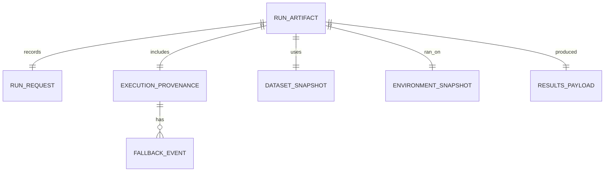

# Route Provenance, Fallback Honesty, and Artifact Metadata for VectorGrid

## Executive Summary

A GPU-aware optimizer needs provenance that distinguishes **what the user asked for**, **what the system planned**, and **what actually ran**—because “GPU-enabled” can mean anything from “some indicators ran on GPU” to “the full simulation and metric path stayed VRAM-resident.” In the current VectorGrid vocabulary, the backend labels already imply materially different execution shapes (CPU-only vs staged GPU indicator compute vs full kernel paths).fileciteturn0file0 fileciteturn0file1

The most defensible pattern—grounded in established provenance and experiment-tracking practice—is to treat each run artifact as an **entity** produced by an **activity** (the run), attributed to **agents** (user + software), with explicit derivations and “provenance-of-provenance” bundling where needed (W3C PROV).citeturn1search4turn1search8 In practical product terms, that becomes: a stable **route taxonomy**, a per-run **stage map** (where each stage ran: CPU/GPU; what precision; where copies occurred), and a structured **fallback event log** when reality diverges from plan.

Recommendation: **Implement Now**, as an **Additive** change: add a `execution_provenance` block to run artifacts/reports and surface a concise “Planned → Realized” badge in the UI; everything else can iterate behind a schema version.

## Fifth Question Text

> `How should a GPU-aware desktop optimizer communicate route provenance and fallback behavior honestly? Use examples from scientific computing tools, quant platforms, and benchmarking/reporting practice to recommend a user-facing and artifact-facing taxonomy for CpuOnly, GpuOnly, GpuKernel, GpuHybridKernel, and Auto that makes exact versus staged versus fallback execution clear. Include recommended wording, metadata fields, warning thresholds, and report/artifact provenance rules that would help users understand what actually happened during a run. Be explicit about which parts of the answer are product judgment rather than external standard.`fileciteturn0file3

## Current VectorGrid Execution Semantics

VectorGrid already defines backend labels with distinct semantics. In particular, `CpuOnly` runs indicators and backtest on CPU; `GpuOnly` runs indicators on GPU but copies to host for CPU backtest; `GpuKernel` is intended as a full GPU/VRAM path for supported constraints; `GpuHybridKernel` exists as a distinct contract but is still being implemented incrementally.fileciteturn0file0 The repo map also clarifies that `Auto` is a **request-time chooser**, not itself a real execution backend, and that these labels matter more than many strategy names because they define the actual runtime route.fileciteturn0file1

That is already a solid foundation; the gap is that the *labels alone* are not enough for honest user understanding unless you also record and display:

- whether the planned route matched the realized route,
- what stage(s) ran where,
- why any fallback happened,
- and whether results are directly comparable across runs when devices/precision differ.

The need for that last point is supported by a recurring theme in scientific/accelerated computing: CPU and GPU executions can differ in reproducibility and numerical behavior even with the “same” algorithmic intent (e.g., PyTorch explicitly warns results may not be reproducible between CPU and GPU even with identical seeds).citeturn0search1

## What Comparable Systems Do and What Transfers

Several mature ecosystems converge on a similar structure: stable identifiers for “runs,” structured tags/attributes for environment and execution context, and an explicit concept of provenance relationships rather than unstructured logs.

image_group{"layout":"carousel","aspect_ratio":"16:9","query":["W3C PROV data model entity activity agent diagram","MLflow tracking UI screenshot runs parameters metrics artifacts","OpenTelemetry semantic conventions resource attributes diagram","PyTorch reproducibility documentation screenshot"],"num_per_query":1}

The entity["organization","World Wide Web Consortium (W3C)","web standards body"] provenance standards define provenance as information about **entities**, **activities**, and **agents** involved in producing a thing, explicitly to support judgments about quality/trust.citeturn1search4 The companion PROV ontology makes those concepts machine-exchangeable.citeturn1search8 This is a strong template for VectorGrid artifacts: treat artifacts as Entities, runs as Activities, and user/app/runtime as Agents.

entity["organization","MLflow","ml experiment tracking"] operationalizes this idea for ML by making “runs” first-class and capturing parameters, metrics, and artifacts, plus metadata like source version when executed in a project context.citeturn0search4turn0search7 VectorGrid can borrow the *shape* (run-centered metadata + artifacts) without adopting MLflow’s platform.

entity["organization","OpenTelemetry","cncf telemetry project"] provides a different but relevant precedent: a standardized schema for describing runtime resources (service name/version, host identifiers, environment, etc.), specifically to keep instrumentation consistent and comparable across systems.citeturn0search0turn0search2turn0search6 VectorGrid can borrow the idea of “semantic conventions”—stable keys that are easy to diff.

From benchmarking disclosure practice, entity["organization","MLCommons","mlperf org"]’ MLPerf guidance emphasizes disciplined reporting and includes generating a **system description** for the “system under test,” reinforcing that credible performance claims require structured machine/hardware/software disclosure, not just timings.citeturn3view0turn2search0turn5search0

From quant tooling, entity["company","QuantConnect","lean platform"]’s local CLI indicates backtest results are stored under a timestamped directory, with logs surfaced in real time and persisted—an example of run-local artifact colocation and a stable “run output root.”citeturn2search1

The specific route names (`CpuOnly`, `GpuKernel`, etc.) are VectorGrid product vocabulary; there is no universal standard for those labels. The transferable standard is the **provenance structure**, not the branding of routes (product judgment).

## Best-Fit Taxonomy for VectorGrid

A taxonomy that creates honest clarity needs two orthogonal concepts:

- **Route intent vs route realization** (planning and fallback),
- **Stage-level execution mapping** (what ran where).

A minimal, stable model is:

- `requested_route`: what the user selected (`Auto` allowed).
- `resolved_route`: the planner’s decision after evaluating availability/capabilities (especially in `Auto`).
- `realized_route`: the route that actually executed end-to-end.
- `stage_map`: per-stage device/precision/copy behavior.
- `fallback_events[]`: structured deviations (if any) with reasons and comparability notes.

A user-facing label should always read as:

**Planned → Realized** (with route badge)  
and optionally a compact stage summary: **[Indicators: GPU] [Backtest: CPU] [Kernel: No]**

A stage map that is both honest and user-comprehensible for the current backend semantics is:

| Route label | Indicators compute | Backtest/sim loop | Key copy boundary | User-facing wording |
|---|---|---|---|---|
| `CpuOnly` | CPU | CPU | none | “CPU-only (all stages on CPU)” |
| `GpuOnly` | GPU | CPU | “Indicators GPU → Host” | “Staged: GPU indicators, CPU backtest” |
| `GpuKernel` | GPU | GPU | ideally none during hot loop | “GPU kernel (VRAM-resident path)” |
| `GpuHybridKernel` | GPU + mixed staging | mixed (by design intent) | depends on which parts are hybrid | “Hybrid GPU route (mixed staging)” |
| `Auto` | (planner decides) | (planner decides) | varies | “Auto (planner-selected route)” |

The exact stage boundaries and wording above are product judgment, but they are constrained by the repo’s own route definitions and intent.fileciteturn0file0 fileciteturn0file1

## Artifact Metadata, Warning Thresholds, and Provenance Rules

### Provenance block fields

The core idea is to keep the artifact provenance block **diffable** (stable keys, limited noise) and **auditable** (explicit reasons when routes change). This mirrors MLflow’s run metadata discipline and OpenTelemetry’s semantic attribute approach.citeturn0search4turn0search0

A practical schema (JSON-like) is:

| Field | Purpose | Source/precedent | Notes |
|---|---|---|---|
| `schema_version` | Safe evolution of keys | PROV bundling concept + general practice | Product judgment |
| `requested_route`, `resolved_route`, `realized_route` | Intent vs plan vs reality | “Run” concept (MLflow), provenance structure (PROV) | Explicitly treat `Auto` as intent, not execution |
| `stage_map` | Stage→device/precision map | Need implied by staged routes; reproducibility cautions | Map should include: device (`cpu`/`gpu`), precision (`f64`/`f32`), and whether copies occurred |
| `fallback_events[]` | Structured deviations | Provenance relations (PROV) | Each event: `from`, `to`, `reason_code`, `stage`, `timestamp` |
| `environment` | OS + machine description | OpenTelemetry resource attributes; MLPerf system disclosure | Keep stable keys (e.g., `service.version`-like “build version”)citeturn0search2turn3view0 |
| `gpu` (optional) | Device + driver/runtime versions | CUDA runtime version APIs | CUDA exposes driver/runtime versions via `cudaDriverGetVersion`/`cudaRuntimeGetVersion`.citeturn1search0 |
| `comparability` | Are results comparable to prior runs? | PyTorch reproducibility warnings | At minimum: “Comparable”, “Precision-changed”, “Device-changed”.citeturn0search1 |

For CUDA-specific fields, the most defensible “primary source” approach is to query driver/runtime versions using NVIDIA’s own runtime APIs (or equivalent system tooling), since those versions are key debugging context when “GPU works on one machine but not another.” The CUDA Runtime API documents both functions and return semantics.citeturn1search0 entity["company","NVIDIA","gpu maker"]

### Warning thresholds and UX rules

There is no universal standard for when to warn; thresholds are product judgment. Still, credible patterns emerge:

- **Always warn (persistent but non-blocking)** when `requested_route != realized_route`, because it signals a meaningful change in performance expectations and sometimes numerical behavior.
- **Always label as “Staged”** when stage map includes a GPU→CPU copy boundary (e.g., `GpuOnly`), because the route name alone may be misread as “fully GPU.”
- **Escalate to stronger warning** when switching between CPU and GPU changes precision or determinism expectations. This is justified by the general principle that CPU vs GPU executions can yield different reproducibility characteristics.citeturn0search1turn0search5
- **For `Auto`**, do not warn merely because the planner chose a route; warn only when Auto chooses a fallback relative to what the user likely expected (e.g., GPU unavailable) or when the same request/dataset selects different routes across runs on the same machine (a “route instability” warning), because that threatens comparability.

### Provenance propagation rules

To avoid “provenance drift,” apply one strict rule: **every exported representation of results must embed or link to the same provenance block**.

- JSON run artifacts: include `execution_provenance` inline.
- XLSX/PDF reports: include a “Run Provenance” section with the Planned→Realized label and a condensed stage map.
- CSV exports: include a small sidecar file (e.g., `run_provenance.json`) rather than trying to cram provenance into CSV headers (product judgment, but aligns with MLflow’s “artifacts can be any files” concept).citeturn0search4

A provenance relationship structure that matches PROV’s mental model is:

This is a deliberate borrowing of PROV’s entity/activity notion (artifact as Entity; run as Activity; user/app as Agent) rather than a claim that you must implement full PROV-O serialization (product judgment).citeturn1search4turn1search8

## Recommendation, Change Shape, Verification, and Risks

**Direct answer:** Implement a provenance block that separates requested/resolved/realized route, includes a stage map, and logs structured fallback events; surface this as “Planned → Realized” in UI and embed it in artifacts and reports. This is the minimum honest representation of GPU-aware behavior.

**Why this matters for VectorGrid:** The product’s credibility depends on route transparency and local-first reproducibility; if users cannot tell whether a run was staged or fully kernel/VRAM-resident—or whether a “GPU” run silently fell back—they cannot compare runs confidently or trust benchmark claims.fileciteturn0file1

**Recommendation:** **Implement Now**

**Change shape:** **Additive** (new metadata + UI badges; no removal of workflows)

**Smallest useful implementation slice:**
1. Add `execution_provenance.schema_version`, `requested_route`, `resolved_route`, `realized_route`, and a minimal `stage_map` to run artifacts.
2. Add a single UI badge: “Planned → Realized” with “Staged” indicator if any GPU→CPU copying occurred.
3. Add `fallback_events[]` only for “route mismatch” cases first; defer fine-grained per-stage fallbacks.

**Verification and benchmark plan:** Use existing repo verification posture (quality gate + artifact/output parity discipline) to prevent schema drift and ensure CPU-only builds remain valid.fileciteturn0file1 Specifically: golden-file tests for provenance presence and stability, plus a small run that intentionally triggers fallback (e.g., request GPU route in CPU-only build) to confirm warning behavior and artifact recording.

**Main risks/counterarguments:** Over-communicating provenance can overwhelm users; the mitigation is to keep UI compact and push details into an expandable panel or artifact section. Another risk is implying that route changes always change semantics; instead, label the *comparability risk* explicitly and conservatively, consistent with reproducibility cautions in accelerated computing.citeturn0search1

**Open questions:** Whether any current GPU paths differ in numerical precision vs CPU (the docs imply CPU f64, but GPU precision specifics may vary by stage); and how much per-stage instrumentation is acceptable without hot-path performance impact (may require local profiling rather than external precedent—per the pack’s guidance).fileciteturn0file0 fileciteturn0file3

## Assumptions

The question pack is explicit that some recommendations will be product judgment; where external precedent is weak, I treat the structure as the transferable part and the exact naming/thresholds as VectorGrid policy.

Assumptions made due to incomplete runtime/UI/code context in this chat:

- Run artifacts already exist as structured files and can be extended without breaking consumers; the repo map indicates a mature artifact workflow and parity checks but does not fully specify the artifact schema here.fileciteturn0file1
- The UI has a place to display a compact route badge (e.g., result header or task status) and a way to thread provenance into reports; details are not provided in the question pack excerpt.fileciteturn0file1
- CUDA builds can safely query driver/runtime versions via CUDA runtime APIs; CPU-only builds will need graceful “not applicable” fields (this is aligned with CUDA’s documented runtime calls but still an implementation decision).citeturn1search0