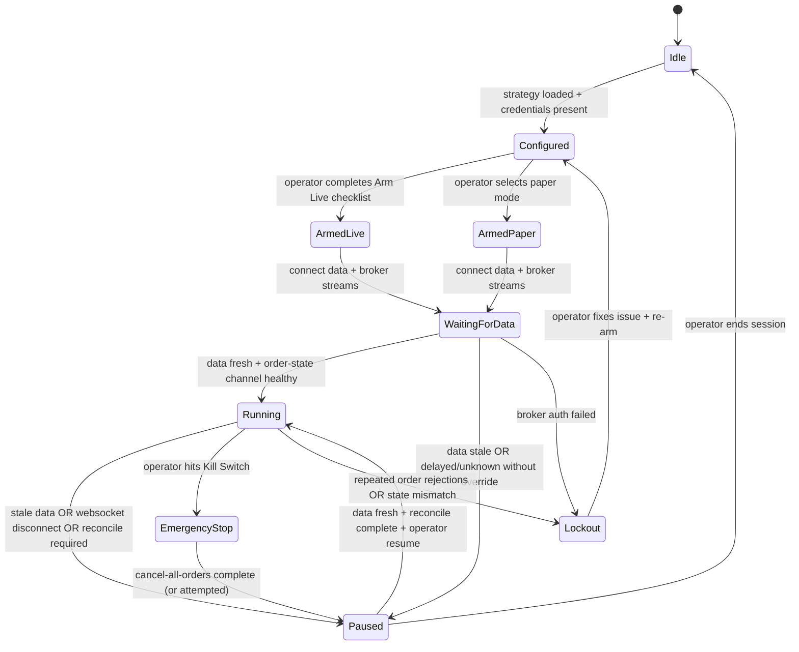

# Locating and Answering Question Eight in VectorGrid’s Deep Research Pack

## Executive summary

Question eight in the referenced file is **DR-08: “Live execution operator safety.”** It asks what *operator-safety* patterns are best for a desktop quant app that turns research outputs into live orders via **entity["company","Alpaca","brokerage api platform"]** and live market data from **entity["company","Polygon.io","market data provider"]**, and it explicitly calls out: dry-run vs live separation, delayed-vs-real-time warnings, stale-data handling, order confirmation, kill switches, audit logs, runner state transitions, and degraded-mode UX.

The most defensible approach—consistent with how regulators and market-structure bodies think about “market access” risk—is **defense in depth**: (1) *hard environment separation* (dry-run → paper → live), (2) *data freshness + entitlement clarity as a gating condition for live trading*, (3) *pre-trade guardrails + explicit confirmation*, (4) *a fast, reliable kill switch*, (5) *append-only, exportable audit logs*, and (6) *a strict runner state machine that fails safe (pause/stop) under uncertainty*. These patterns map cleanly to capabilities exposed by Alpaca’s APIs (trade updates stream, cancel-all-orders, close-all-positions, order endpoints) while acknowledging that paper trading is an approximation and can diverge materially from live fills and slippage. citeturn4view2turn4view3turn1search2turn2search1turn2search6

The **smallest set of safety improvements that should exist before expanding live execution breadth** is a focused “Live Safety Envelope” that adds: an explicit *Arm Live* step, a persistent environment banner, feed-delay and staleness detection with default “pause,” a two-step order confirmation with computed notional/risk, a one-click “Cancel all orders” and “Pause runner” kill switch (with optional “Close all positions” behind a stronger confirmation), and an append-only event timeline artifact for every session.

## Question eight extracted from the file

I accessed the file in the provided environment at:

`/mnt/data/VECTORGRID_DEEP_RESEARCH_QUESTION_PACK_2026-04-09.md`

Using a direct text lookup for the section header `### DR-08`, I extracted the **exact** prompt line (shown in the file immediately under the DR-08 header):

```
What operator-safety patterns are best for a desktop quant app that connects research results to live execution using Alpaca and Polygon? Cover dry-run versus live separation, delayed versus real-time data warnings, stale-data handling, order-confirmation models, kill switches, audit logs, runner state transitions, and degraded-mode UX. Recommend the smallest set of safety improvements that should exist before expanding live execution breadth.
```

## How I interpreted the question and what I did

### Interpretation

I interpret DR-08 as asking for **operator-safety controls at the product boundary** (desktop UI + local runtime + broker/data APIs), not for alpha design. The core problem is that **research workflows tolerate approximation**, but **live execution punishes ambiguity**. Operator safety therefore means:

- the operator is never confused about whether the system is in *dry-run, paper, or live* mode,
- the system never trades live under *unknown data timeliness* or *unknown account/order state*,
- the operator can quickly *pause* and *neutralize risk* (cancel open orders; optionally flatten),
- the system creates an **auditable record** of what it did and why, and
- the runner behaves like a **state machine with fail-safe transitions** (degraded modes halt or pause).

### Research steps taken

1. **Located and extracted DR-08** from the local file path above (confirmed by matching the `### DR-08` header and the backticked question line in the markdown file).
2. Reviewed **primary execution and safety-relevant API surfaces** in Alpaca’s official documentation:
   - paper trading behavior and limitations, and environment separation citeturn4view2
   - websocket “trade_updates” stream and endpoints for paper vs live citeturn4view3
   - endpoints enabling operational kill-switch behavior (cancel all orders; liquidate positions) citeturn1search2turn2search1
   - order-entry contract and supported order types citeturn2search6
3. Collected **primary / official evidence** for delayed-vs-real-time feed realities and late prints from Polygon/Massive documentation snippets indicating 15-minute delayed vs real-time plan tiers and delayed feed availability. citeturn6search1turn6search0turn1search3
4. Anchored “kill switch / pre-trade / post-trade control” expectations in **official regulatory and market-structure guidance**, treating these as *principles to borrow* (even when the app itself is not a broker-dealer):
   - Market Access Rule concepts (risk controls; post-trade reports) from the **entity["organization","U.S. Securities and Exchange Commission","us securities regulator"]** FAQ and rule text citeturn0search7turn0search19
   - Direct electronic access principles (pre- and post-trade controls complement each other) from **entity["organization","International Organization of Securities Commissions","global securities regulators body"]** citeturn3search3
   - explicit “kill switch” language from **entity["organization","Commodity Futures Trading Commission","us derivatives regulator"]** advisory material citeturn3search0
   - supervisory “kill switch” questioning from **entity["organization","Financial Industry Regulatory Authority","us broker-dealer regulator"] citeturn3search1**
   - (as additional cross-jurisdiction support) algorithmic-trading supervisory framing from **entity["organization","European Securities and Markets Authority","eu securities regulator"]** citeturn3search2

Where I recommend product behaviors that are not explicitly specified in these sources (for example, an exact UI confirmation flow), I label them as **design inference** rather than “standard.”

## Operator-safety patterns supported by primary sources

### Hard mode separation and unmistakable environment identity

A desktop quant app should treat “dry-run,” “paper,” and “live” as **different operational environments**, not a toggle buried in settings.

Why this is strongly supported:

- Alpaca emphasizes that paper trading is a simulation and “not a substitute for real trading,” naming concrete gaps (market impact, latency slippage, queue position, etc.). That alone implies you need explicit separation and operator-facing caution when transitioning to live. citeturn4view2
- Alpaca also documents that paper trading uses **different API keys** and (commonly) a different base URL (`paper-api.alpaca.markets`), which makes “environment identity” something you can enforce technically, not just via UI. citeturn4view2

Best-practice pattern (design inference, but strongly motivated by the above):

- Use a **persistent top-of-window banner** showing:
  - Environment: Dry-run / Paper / Live
  - Broker: Connected / Disconnected
  - Data: Real-time / Delayed (15m) / Unknown
  - Last tick age: X seconds
- Require an explicit **Arm Live** ritual each session (see below), rather than allowing a background state to persist silently across app restarts.

### Treat data timeliness as a first-class execution constraint

If your execution logic depends on intraday bars/quotes, **delayed data is not “a little worse,” it is a different world-state**.

Evidence anchors:

- Polygon/Massive documentation for WebSocket channels explicitly distinguishes **15-minute delayed** vs **real-time** access by plan tiering, which means the product must assume that many users will be running delayed feeds unless they have the right plan/entitlement. citeturn6search1turn6search0
- Polygon/Massive also explains that **late bars/trades can occur** (e.g., trades reported late), including the note that **FINRA can have up to 15 minutes to report a trade** in certain contexts. This is a direct warning that “latest bar” is not always final at the instant you receive it. citeturn1search3

Best-practice pattern:

- When “Live” is armed, continuously compute:
  - `now_exchange_aligned - last_market_event_timestamp`
  - data mode: delayed / real-time / unknown (from configuration/plan choice)
- Define a **staleness budget** (design choice; commonly 2–10× your bar size; tighter for quote-driven logic), and if exceeded:
  - automatically transition the runner to **Paused: Stale Data**
  - block new order submissions until operator acknowledges and data recovers

### Prefer push-based account/order truth and reconcile via REST

Alpaca provides WebSocket streaming specifically for **trade/account/order updates**, including fills, partial fills, cancellations, and rejections. citeturn4view3

Safety implication:

- In live mode, you want your runner to be driven by **authoritative order-state events** (trade updates) rather than polling-only, because *timing mismatches* can cause duplicate orders or incorrect risk assumptions.

Best-practice pattern:

- Subscribe to Alpaca’s `trade_updates` stream and treat it as the primary “truth feed” for order lifecycle. Alpaca documents using `wss://paper-api.alpaca.markets/stream` vs `wss://api.alpaca.markets/stream`, which also reinforces environment separation. citeturn4view3
- On any discrepancy or missed heartbeat, reconcile with REST (e.g., fetch open orders / positions) before allowing additional order placement (design inference).
- Treat “unknown state” as unsafe: pause.

Anecdotal but relevant operational signal (clearly labeled as non-primary):

- Recent forum discussions describe edge cases where order state appears inconsistent across surfaces (e.g., partially filled behavior seen differently across API/dashboard), illustrating why “pause on uncertainty + reconcile” is prudent. citeturn2search3

### Kill switches are a must-have, and APIs exist to implement them

Regulatory and best-practice guidance consistently treats kill switches as core safeguards in automated trading contexts:

- CFTC advisory material explicitly discusses “KILL SWITCH” capabilities and the ability to disconnect or halt activity when a glitch occurs. citeturn3search0
- FINRA examination prompts explicitly ask about automatic/manual shutoffs (“kill switches”) and responsibility/level of application. citeturn3search1
- IOSCO’s DEA principles emphasize layered pre- and post-trade controls; kill switches fit that model as an emergency control. citeturn3search3

Alpaca provides specific endpoints that map directly to kill-switch actions:

- **Cancel all open orders** via `DELETE /v2/orders` (paper endpoint shown; live is analogous). citeturn1search2
- **Close (liquidate) all positions** via `DELETE /v2/positions` with an option to cancel orders first. citeturn2search1

Best-practice pattern:

- Provide at least two kill switch actions:
  1. **Pause runner + Cancel all open orders** (fast, low-regret, should be one click + confirm)
  2. **Close all positions (flatten)** (higher-regret, should be behind stronger confirmation and clear warnings)

Also: Alpaca’s “delete all orders” and “close all positions” endpoints can return per-order results and failure conditions; the UI must surface partial failure clearly (not “ok” when some orders could not be canceled). citeturn1search2turn2search1

### Pre-trade guardrails and explicit confirmation are consistent with market-access thinking

While SEC Market Access Rule obligations apply to broker-dealers with market access (not necessarily to an end-user desktop app), the concepts are still useful “north stars”:

- SEC guidance describes risk management controls designed to prevent problematic order entry and to ensure post-trade execution reporting for supervision. citeturn0search7
- The rule text frames risk controls as reasonably designed to manage financial/regulatory/operational risks of market access. citeturn0search19

Practical product translation (design inference):

- Provide **pre-trade checks** in the client before sending an order:
  - max notional per order
  - max position size
  - max order rate
  - price band checks (e.g., reject limit prices too far from last trade/quote)
  - “symbol allowlist” (only trade symbols tied to the currently loaded dataset/universe)
- Provide **order confirmation** as a two-stage commit:
  - Stage 1: preview computed order impacts (estimated notional, resulting exposure, last price age, environment)
  - Stage 2: a deliberate confirmation (typed “LIVE” or hold-to-confirm)

These are not “regulatory compliance,” but they borrow the proven idea: *the last safe place to stop a bad order is before it’s submitted.*

## Minimum safety slice for VectorGrid before broader live execution expansion

This section answers the prompt’s last sentence: the smallest set of improvements that should exist **before expanding live execution breadth**.

### A focused “Live Safety Envelope” (recommended)

The goal is not to implement institutional-grade risk, but to eliminate the most common and most dangerous failure modes: wrong environment, stale/delayed data, runaway order submission, inability to halt quickly, and lack of auditable evidence.

#### Key controls and their rationale

| Control (minimum slice) | What it prevents | UX shape | Implementation anchors |
|---|---|---|---|
| Persistent environment banner + separate credential slots | “I thought it was paper/dry-run” mistakes | Always visible header with color/state | Alpaca paper vs live uses distinct API keys / base URLs, making enforcement feasible. citeturn4view2turn4view3 |
| “Arm Live” step each session (no silent carryover) | Accidental live activation after restart | Modal checklist + typed confirm | Alpaca highlights paper ≠ live and lists gaps; treat live as opt-in with friction. citeturn4view2 |
| Data mode + staleness gate (auto-pause on stale/unknown) | Trading on delayed feed or dead feed | Runner transitions to Paused: Stale Data | Polygon/Massive distinguishes delayed vs real-time; late prints exist. citeturn6search1turn1search3 |
| Push-based order truth + reconcile on uncertainty | Duplicate orders, incorrect exposure | Status timeline + “reconcile now” | Alpaca `trade_updates` stream covers fills/cancels/rejects. citeturn4view3 |
| Pre-trade guardrails (limits, bands, rate caps) | Fat-finger orders, runaway loops | Inline warnings → hard blocks | Market-access guidance expects risk controls; adapt concept locally. citeturn0search7turn0search19turn3search3 |
| Kill switch: Pause + Cancel All Orders (one click) | Inability to stop quickly | Footer panic button + confirm | Alpaca supports cancel-all-orders endpoint; kill-switch guidance is explicit. citeturn1search2turn3search0turn3search1 |
| Secondary kill switch: Close All Positions (strong confirm) | Rapid risk neutralization when needed | Separate “Flatten” action | Alpaca supports close-all-positions; treat as higher-regret. citeturn2search1 |
| Append-only audit log artifact (exportable) | “We don’t know what happened” | Timeline panel + export | SEC/IOSCO emphasize post-trade reporting/controls conceptually; implement locally. citeturn0search7turn3search3 |

### Runner state transitions as a fail-safe state machine

A clear state machine is the simplest way to make degraded-mode behavior deterministic and testable (design inference). The transitions below are chosen to “fail safe”: uncertainty drives **Paused** or **Lockout**, never “keep trading.”



Safety-critical behavior tied to sources:

- The “order-state channel healthy” condition is motivated by Alpaca’s explicit `trade_updates` stream for fills/cancels/rejections—i.e., the API itself treats push updates as a core mechanism for keeping an accurate picture of account activity. citeturn4view3
- “EmergencyStop” is enabled by Alpaca’s cancel-all-orders endpoint and supported by the broader kill-switch guidance from CFTC/FINRA. citeturn1search2turn3search0turn3search1
- “Delayed/unknown” gating reflects Polygon/Massive’s explicit separation of delayed vs real-time entitlements and the existence of late-reported prints. citeturn6search1turn1search3

### Concrete “smallest useful” feature cut (an implementable checklist)

This is the minimal feature set I would require before “expanding live execution breadth” (more symbols, more strategies, more automation), because it closes the highest-severity failure modes first.

1. **Three-mode execution selector (Dry-run / Paper / Live)** with:
   - separate credential storage slots,
   - persistent banner,
   - mode shown in exports/logs (design inference).
   - Supported by Alpaca’s paper/live separation and different endpoints. citeturn4view2turn4view3

2. **Arm Live gate** (session-scoped) requiring:
   - confirmation of data mode (real-time vs delayed) and a crisp warning if delayed,
   - acknowledgment that paper trading diverges from live (Alpaca’s documented gaps). citeturn4view2

3. **Data freshness monitor**:
   - staleness threshold triggers auto-pause,
   - operator override for delayed feeds must be explicit and sticky only for that session (design inference).
   - Motivated by delayed plan availability and late bars/trades. citeturn6search1turn1search3

4. **Order confirmation and guardrails**:
   - show last price age; show notional; show resulting exposure; block if stale,
   - implement max-order-size and max-rate caps.
   - Supported conceptually by market-access risk-control framing. citeturn0search7turn3search3
   - Ensure order types match supported Alpaca contract (equities: market/limit/stop/stop_limit/trailing_stop, etc.). citeturn2search6

5. **Kill switch controls**:
   - **Cancel all open orders** (one click + confirm) via Alpaca endpoint. citeturn1search2
   - Optional: **Close all positions** (separate “Flatten” with stronger confirm) via Alpaca endpoint. citeturn2search1
   - Rationale strongly supported by kill-switch guidance. citeturn3search0turn3search1

6. **Append-only audit log per session**:
   - include timestamps, market data freshness snapshots, every order request/response, each `trade_updates` event, runner state transitions, and emergency actions.
   - Rationale supported by SEC/IOSCO emphasis on risk controls + post-trade reporting as complementary safeguards (applied here as a product trust requirement). citeturn0search7turn3search3

## Sources

### Primary / official sources consulted (inline citations point to these)

- Alpaca documentation: Paper Trading (paper-vs-live differences; separate keys/endpoints; simulation limitations). citeturn4view2  
- Alpaca documentation: Websocket Streaming (`trade_updates`; paper vs live WebSocket endpoints). citeturn4view3  
- Alpaca API reference: Delete All Orders (`DELETE /v2/orders`). citeturn1search2  
- Alpaca API reference: Close All Positions (`DELETE /v2/positions`, with `cancel_orders` option). citeturn2search1  
- Alpaca API reference: Create Order (supported order types by asset class). citeturn2search6  
- Polygon/Massive WebSocket documentation snippets: plan tiers indicating **15-minute delayed** vs **real-time** websocket access. citeturn6search1turn6search0  
- Polygon/Massive knowledge-base snippet: late aggregate bars; note on late-reported trades (FINRA reporting window reference). citeturn1search3  
- SEC staff guidance FAQ on Rule 15c3-5: risk controls and post-trade execution reports (conceptual anchor). citeturn0search7  
- Rule 15c3-5 text (Cornell Legal Information Institute): market access risk-management controls framing. citeturn0search19  
- CFTC Technology Advisory Committee document snippet: explicit “kill switch” capability recommendation. citeturn3search0  
- FINRA targeted examination letter: asks firms to describe kill switches (evidence of supervisory expectation). citeturn3search1  
- IOSCO principles for Direct Electronic Access: pre- and post-trade controls are complementary. citeturn3search3  
- ESMA supervisory briefing (cross-jurisdiction context on risk controls / kill switches / governance). citeturn3search2  

### Local files consulted in the environment (non-web, for question location and repo context)

- `/mnt/data/VECTORGRID_DEEP_RESEARCH_QUESTION_PACK_2026-04-09.md` (source of the DR-08 prompt text; extracted exactly as shown above)  
- `/mnt/data/REPO_MAP.md` and `/mnt/data/ARCHITECTURE_NOTES.md` (used as background context on the product’s live execution/data integration posture and guardrails)