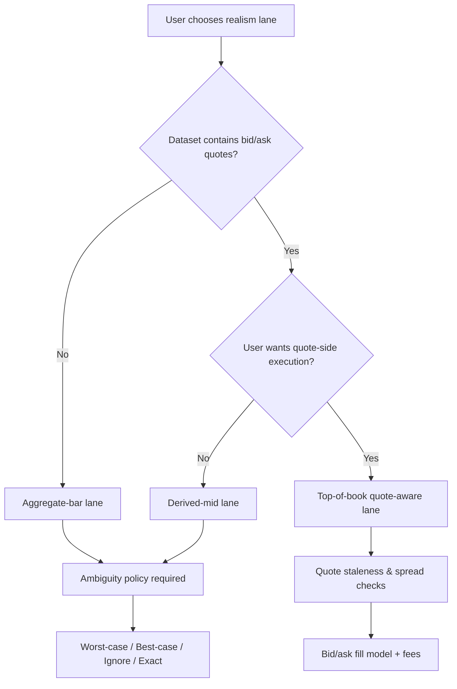

# VectorGrid DR-10: Options realism lanes and semantic clarity

## Extracted question text

```markdown
### DR-10 - Options realism lanes and semantic clarity

`For intraday options strategy optimization, what are the most defensible execution semantics across aggregate-bar realism, derived-mid realism, and quote-aware top-of-book realism? Define the terminology, artifact wording, user-facing warnings, and product-policy boundaries that keep these lanes clear and honest. Recommend how VectorGrid should separate a fast canonical lane from a more realistic lane without confusing users about what each result means. Favor additive lane clarification and reporting over proposals that would replace the current options workflow.`
```

Extracted from `VECTORGRID_DEEP_RESEARCH_QUESTION_PACK_2026-04-09.md`. fileciteturn0file0

## Executive summary

A defensible intraday options “realism” design starts by acknowledging what information each data shape can and cannot support, and then hard-locking execution semantics to the **minimum information actually present**. The three lanes can be made both honest and useful by: (1) treating **aggregate-bar** as a fast *research* lane that cannot claim tradable bid/ask execution, and adopting an explicit **worst‑case** resolution for intra-bar ambiguity; (2) treating **derived-mid** as an intermediate lane whose fills are explicitly **non-executable mid proxies** (useful for ranking and sensitivity, not for tradability claims); and (3) treating **top-of-book quote-aware** as the only lane that can claim **quote-side** execution semantics (buy at ask, sell at bid), while still warning that consolidated feeds reflect **Level 1 (top-of-book) visibility**, not depth/queue or guaranteed fill quantity. This aligns with the repo’s current posture that `TopOfBookQuote` is the only true quote-side lane and that `MinuteAggregate` / `DerivedMidSnapshot` remain aggregate-style in backend execution. fileciteturn0file7

For product clarity, VectorGrid should keep **one canonical fast lane** (aggregate) for broad GPU search, and offer **a realistic validation lane** (top-of-book quotes) for finalist re-scoring and reporting. The UI and artifacts should always surface: lane name, data provenance, fill model, timestamp semantics (bar end vs start), intra-bar ambiguity policy, and what claims are disallowed. This follows established practice in mature backtest engines: clearly disclose how OHLC-only ambiguity is resolved and provide an “exact / higher-granularity” path when the user wants more realism at higher compute cost. citeturn8view2turn8view0turn4view0

## Terminology and semantic model

The key to “semantic clarity” is to separate **data semantics** from **execution semantics**, then constrain execution to what the data can justify.

**Data semantics (what you actually have)**

- **Aggregate-bar**: contract-level OHLC(V) bars over a time bucket (often 1 minute). These bars summarize a period but do not reveal the full price path inside the minute, nor the full bid/ask state. This naturally creates “not uniquely decidable” cases when stop and target can both occur within the same bar range. citeturn8view2turn8view0  
- **Derived-mid**: a midpoint-like series derived from quotes (or from bid/ask aggregates), typically representing “the mean of bid and ask” in some sampled or aggregated way. QuantConnect’s `QuoteBar` definition is a concrete example: it consolidates NBBO quotes and defines the bar’s OHLC (for the bar itself) as the **mean of bid and ask** for each OHLC component. citeturn4view0  
- **Top-of-book quote-aware**: time-stamped best bid/offer (and sizes) quotes. In U.S. listed options, OPRA’s Pillar specifications explicitly describe calculating and disseminating the “Best Bid and Best Offer” (BBO). citeturn1view0turn1view1

**Execution semantics (what you claim about fills)**

- A credible engine must define: **decision time**, **earliest tradable time**, **fill price rule**, and **ambiguity resolution**. QuantConnect’s documentation highlights why “bar time semantics” matter: bars have start/end times and emitting at end time avoids receiving information “before it was actually available” (a common lookahead trap when a vendor timestamps to bar start). citeturn3view2  
- A credible engine must treat **spread costs** as execution costs, not optional decoration; bid–ask spreads “measure trade execution costs” and materially affect realized results. citeturn1view3

VectorGrid’s repo already uses a version of this separation by treating price semantics as the lane-defining contract and restricting quote-side fills to `TopOfBookQuote`. fileciteturn0file7

## Comparative semantics and trade-offs

The table below compares **defensible minimum semantics** for each lane (i.e., what can be claimed without overstating realism).

| Lane | What the input represents | Defensible entry/exit fill rule | Intra-bar target/stop ambiguity | Strengths | Primary honesty risks |
|---|---|---|---|---|---|
| Aggregate-bar realism | OHLC over a period; not the full path; no guaranteed bid/ask | “Research fill” anchored to **known times** (e.g., next bar open after decision) and **explicit costs model** (fees/slippage as configuration) | Must be explicit; recommend **worst-case** when not uniquely decidable (or “exact” by requesting finer data) | Fast, cacheable, GPU-friendly; broad search | Over-claiming executability; hiding ambiguity; hidden lookahead if bar timestamping is mishandled citeturn8view2turn3view2turn8view0 |
| Derived-mid realism | Midpoint proxy (often mean of bid+ask); may be sampled/aggregated | Fill at **mid** (or mid-like) but explicitly labeled **non-executable** unless separately validated; no quote-side claims | Same ambiguity problem if mid is bar-aggregated; resolve explicitly (worst-case / ignore / exact) | Better “fair value” proxy for ranking; useful sensitivity check | Users interpret “mid” as tradable; it can systematically bias performance evaluation if treated like execution citeturn4view0turn9view0 |
| Quote-aware top-of-book realism | Best bid/offer quotes and sizes (Level 1) | Long: buy at **ask**, sell at **bid** (or defined conservative variant); incorporate spread and fees; apply staleness rules | Reduced but not eliminated: quote sampling and gaps still create ordering uncertainty; define tie-break rules | Most defensible for intraday execution claims without full depth; can model spread costs directly citeturn1view0turn1view1turn4view1 | Still not full depth/queue; top-of-book ≠ guaranteed fill size/impact; must warn about limitations of Level 1 feeds citeturn10view1turn10view0 |

**Why “worst-case” is the most defensible default (for bar-based ambiguity)**  
When only candle/aggregate bars are available, some order outcomes are “not uniquely decidable.” A rigorous approach is to (a) warn the user, and (b) offer explicit policies such as worst-case, best-case, ignore, or exact (requiring more granular data). The “worst case” policy is defensible for product honesty because it avoids optimistic bias and communicates uncertainty directly. citeturn8view2

**Why “quote-aware” should be the only lane allowed to claim bid/ask execution**  
OPRA Pillar specifications describe OPRA’s role in consolidating options market data and identifying the BBO. citeturn1view0turn1view1  
By contrast, midpoints and OHLC bars are derived abstractions; they can be useful for research, but they do not, by themselves, justify claims like “filled at the ask” or “spread captured,” because they may not contain the required side-of-market state at the decision timestamp. citeturn1view3turn4view0



## Recommendations for VectorGrid lane separation and reporting

### Lane naming and one-sentence truth statements

VectorGrid should standardize lane names and always show a “truth sentence” next to the selector and in artifacts.

- **Aggregate (Canonical / Fast)**  
  Truth sentence: “Uses contract-level aggregate bars; does *not* simulate bid/ask execution; intra-bar outcomes use an explicit ambiguity policy.” citeturn8view2turn3view2  
- **Derived Mid (Intermediate / Fair‑value proxy)**  
  Truth sentence: “Uses midpoint-derived prices; results are not executable fills; use for ranking and sensitivity, not for quote-side realism.” citeturn4view0turn9view0  
- **Top-of-Book Quote-Aware (Realistic / Conservative)**  
  Truth sentence: “Uses best bid/offer quotes; executes long entries at ask and exits at bid (or configured quote-side rule); still Level 1 (no depth/queue).” citeturn1view0turn1view1turn10view1

This directly matches the repo’s existing posture that three price semantics families exist and that `TopOfBookQuote` is the only true quote-side semantics. fileciteturn0file7

### Canonical fast lane vs realistic lane split

A clear, non-confusing separation is:

- **Fast canonical lane (Aggregate)** = **search lane**  
  Use for broad GPU optimization, candidate discovery, and rapid exploration.  
- **More realistic lane (Top-of-book quote-aware)** = **validation / finalist lane**  
  Use to re-score finalists, produce decision-grade reporting, and surface fragility (e.g., how much of the edge disappears when paying the spread). Quote-aware semantics naturally support modeling spread costs via bid/ask. citeturn4view0turn4view1turn1view3  

This mirrors the reality of mature tools: higher-granularity or quote-aware fill modeling improves realism but costs more compute and data handling. NinjaTrader documents this as a user-visible trade: standard backtests use a historical fill algorithm, while a “High” order fill resolution can add a secondary (more granular) series at the cost of longer processing. citeturn8view0

### Artifact wording and required metadata fields

Every saved run artifact should carry lane-defining fields that make it hard to misread results.

Minimum recommended fields (names illustrative):

- `price_semantics`: `MinuteAggregate | DerivedMidSnapshot | TopOfBookQuote` (already present as a core concept). fileciteturn0file7  
- `fill_model`: explicit enum; quote-side models only allowed when quote semantics exist. QuantConnect’s docs frame fill models as the mechanism that determines fill price/quantity and can incorporate spread costs. citeturn4view1  
- `bar_timestamp_policy`: `bar_emitted_at_end_time = true/false` (or equivalent) to prevent implicit lookahead. citeturn3view2  
- `decision_time_alignment`: e.g., “decisions computed on bar close; earliest tradable = next bar open” (or “first quote at/after decision time” for quote lanes).  
- `intra_bar_ambiguity_policy`: `worst_case | best_case | ignore | exact` (explicitly documented as user-selectable or fixed-by-policy). The candle-chart backtesting literature argues that the engine must inform the user how non-unique situations are handled and should warn the user. citeturn8view2  
- `quote_scope`: `top_of_book_only = true` with a warning string explaining that Level 1 does not provide full depth. citeturn10view1turn10view0  
- `data_provenance`: include feed/source (e.g., OPRA-derived, vendor, import) and whether quotes were firm/non-firm if that distinction exists in the feed. OPRA’s output spec includes quote message indicators such as “Non-Firm Quote.” citeturn1view1  

### User-facing warnings that actually prevent misuse

Warnings should be tied to *specific* semantic risks rather than generic “backtests aren’t real.”

- **Aggregate lane warnings**
  - “This lane cannot model bid/ask execution or queue; use quote-aware lane for spread realism.” citeturn1view3turn4view0  
  - “If target and stop are both inside the same bar range, VectorGrid applies: `worst_case` (configurable).” This reflects the need to resolve non-unique candle situations explicitly. citeturn8view2turn8view0  
  - “Bars are interpreted using end-time semantics to avoid lookahead.” citeturn3view2  
- **Derived-mid lane warnings**
  - “Mid fills are not executable; treat results as ranking/sensitivity.” QuoteBar definitions make clear the mid is a mean of bid/ask, not a guaranteed execution price. citeturn4view0turn1view3  
  - “Mid-based evaluation can bias performance or cost inferences if treated like execution.” citeturn9view0  
- **Quote-aware lane warnings**
  - “Top-of-book quotes model best bid/offer but not depth/queue; fills are simulated, not guaranteed.” citeturn10view1turn10view0  
  - “Quote gaps/staleness can create implicit ambiguity; results include quote coverage diagnostics.” (Stale fills are a recognized backtest realism issue in fill modeling discussions. citeturn4view1)

### Product-policy boundaries to lock semantics

To keep lanes “clear and honest,” VectorGrid should enforce these boundaries in code and UI:

- **No quote-side fills without quote-side inputs**: bid/ask fill rules must be rejected unless the dataset is quote-aware. This matches VectorGrid’s current stance that quote-side execution semantics only apply to `TopOfBookQuote`. fileciteturn0file7  
- **No derived-mid relabeling as quote-aware**: derived-mid should remain explicitly “aggregate-style in backend execution,” even if it is sourced from quotes, unless the product truly simulates bid/ask side fills. fileciteturn0file7  
- **Explicit “research vs execution” labeling**: aggregate and derived-mid lanes should be labeled as “research realism,” while quote-aware is “quote-side realism,” echoing the principle that spread costs and fill rules are part of reality modeling. citeturn4view1turn1view3  

## Assumptions and missing details

The extracted prompt does not specify several details that materially affect “most defensible” semantics. The recommendations above assume the following (or note where a choice is required):

- **Market regime and feed scope**: I assume U.S.-listed equity options with OPRA-like consolidated top-of-book quote semantics; other venues may differ. citeturn1view0turn10view1  
- **Order type model**: I assume the optimizer primarily evaluates **template exits** (hold/target/stop) rather than a full exchange order book simulation; therefore the main ambiguity is within-bar ordering and quote availability, not queue position. citeturn8view2turn10view1  
- **Resolution**: I assume minute-level data is common for the fast lane. If you run at coarser bars (e.g., 5m), ambiguity and execution error increase. citeturn8view2  
- **Transaction costs**: Fees/commissions/slippage models are not specified; any “realism lane” should include them explicitly because bid–ask spreads and costs affect realized results. citeturn1view3turn4view1  
- **Assignment/exercise**: Intraday options strategies may still face early exercise risk (especially around dividends), but the prompt does not ask for exercise/assignment semantics; the lane model here focuses on intraday fill realism, not lifecycle modeling.  
- **Quote staleness thresholds**: The exact definition of “stale” (seconds, minutes, session) is not specified; it should be explicit, lane-dependent, and stored in the artifact. citeturn4view1  

## Sources

- entity["organization","Options Price Reporting Authority","us options sip"] Pillar input specification (OPRA calculates/disseminates Best Bid and Best Offer). citeturn1view0  
- OPRA Pillar output specification (quote message fields include bid/offer prices and sizes; quote message indicators include non-firm flags). citeturn1view1  
- entity["company","QuantConnect","algorithmic trading platform"] documentation on `QuoteBar` (NBBO quote bars; bar OHLC defined as mean of bid/ask) and on fill modeling concepts. citeturn4view0turn4view1  
- QuantConnect documentation on bar start/end time semantics and lookahead risk when data is timestamped incorrectly. citeturn3view2  
- entity["company","NinjaTrader","trading software vendor"] documentation on historical fill processing (virtual-bar algorithm; higher granularity via secondary series; realism vs speed trade). citeturn8view0  
- entity["people","Stanislaus Maier-Paape","mathematician"] and entity["people","Andreas Platen","researcher"], “Backtest of Trading Systems on Candle Charts” (non-unique candle situations; explicit policies such as worst-case/best-case/ignore/exact; engines should warn users). citeturn8view2  
- entity["people","Hendrik Bessembinder","finance professor"] and Kumar Venkataraman, “Bid-Ask Spreads: Measuring Trade Execution Costs in Financial Markets” (bid–ask spreads as execution costs; midpoint as common benchmark). citeturn1view3  
- entity["people","Bjorn Hagstromer","finance academic"], “Bias in the Effective Bid-Ask Spread” (midpoint-based measures can be biased; reinforces that mid is not a free execution assumption). citeturn9view0  
- Data vendor microstructure guide explaining OPRA as Level 1 (trades and quotes) and noting that depth requires proprietary exchange feeds. citeturn10view1  
- Technical explainer noting OPRA’s top-of-book nature and explicitly stating what is not included (no full depth; proprietary feeds needed for deeper book detail). citeturn10view0