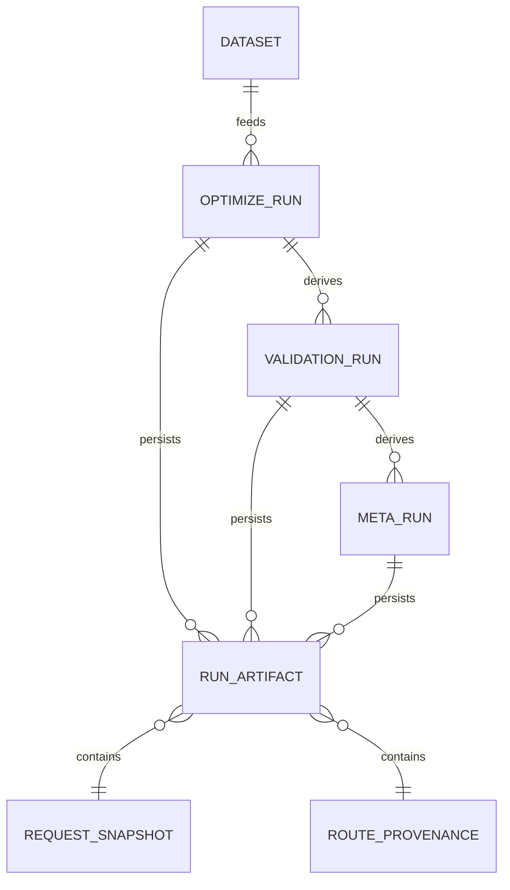

# Selective Parity Gaps Between VectorGrid and VectorBT Pro

## Executive summary

The file `VECTORGRID_DEEP_RESEARCH_QUESTION_PACK_2026-04-09.md` **was accessible** in this environment at `/mnt/data/VECTORGRID_DEEP_RESEARCH_QUESTION_PACK_2026-04-09.md`, and I extracted the first question (DR-01) and its surrounding answer-contract context **verbatim** (see the next section).

DR-01 asks for the *highest-value selective parity gaps* between VectorGrid and VectorBT Pro, **ranked by impact** on: research power, correctness, validation trust, dataset workflow, experiment comparison, and product credibility—and for each gap, whether VectorGrid should **Implement**, **Backlog**, **Doc Only**, or **Reject**.

Based on: (a) VectorGrid’s explicit guardrails (desktop, local-first artifacts, optional CUDA, no unrestricted user code) in the question pack and repo architecture notes, (b) VectorBT Pro’s official feature surfaces (analysis, portfolio, data, optimization, performance), and (c) established lineage/experiment-tracking practices (PROV, MLflow, DVC), the top parity gaps that most plausibly maximize competitive impact *without breaking the product thesis* are:

- **Visualization & exploratory analysis depth** (Implement Now, additive): VectorBT emphasizes interactive analysis layers such as trade-signal plotting and richer trade-metric analysis, including “expanding” MAE/MFE-style trade metrics and time-window analysis. citeturn2search1turn4search9  
- **Experiment comparison & lineage / run intelligence** (Implement Now, additive): Modern research tooling treats “compare runs,” “diff inputs,” and “artifact lineage” as first-class; MLflow and DVC explicitly center reproducible run logging and comparison. citeturn3search1turn0search12turn3search2  
- **Dataset catalog + saved universes + provenance** (Backlog, mostly additive): VectorBT Pro invests in data pulling and caching (including disk caching using LMDB with hashed keys); VectorGrid’s roadmap identifies dataset/universe management as a key competitiveness multiplier, especially as a prerequisite for portfolio workflows. citeturn4search19turn1search1  
- **First constrained portfolio / basket research surface** (Backlog, mostly additive): VectorBT Pro supports portfolio simulation extensibility and portfolio optimization/rebalancing patterns; VectorGrid should pursue a bounded “portfolio-of-candidates” domain model rather than callback-driven engines. citeturn2search3turn4search16  
- **Constrained feature engineering / indicator-expression ergonomics** (Backlog, mostly additive): VectorBT Pro exposes indicator “expressions” that rely on arbitrary Python expression evaluation; for VectorGrid, the parity target must be a safe, typed, declarative equivalent. citeturn4search1turn4search14  
- **Crash-safe long-run orchestration & resumability (chunk caching)** (Backlog, additive): VectorBT Pro’s execution framework can cache intermediate results to disk and resume after faults; for a desktop GPU product, adopting a constrained version may improve credibility for “long sweeps” without changing core semantics. citeturn1search0  

Two tempting “parity” targets should be explicitly **rejected or narrowed** because they conflict with VectorGrid’s guardrails:

- **Unrestricted callback-based portfolio simulation** as a user-facing feature (Reject): VectorBT Pro explicitly supports callbacks throughout portfolio simulation; that openness is incompatible with a guardrailed, reproducible desktop product unless translated into bounded declarative primitives. citeturn2search3  
- **Arbitrary Python-expression evaluation for configs/indicators** (Reject as-is; pursue constrained alternative): VectorBT Pro highlights evaluation of arbitrary Python expressions in configuration/indicator-expression systems; VectorGrid should not adopt that mechanism directly. citeturn4search14turn4search1  

## Extracted question and surrounding context

Below is the **verbatim** excerpt containing the “global context block,” the “required answer contract,” and the first question (DR-01) from `/mnt/data/VECTORGRID_DEEP_RESEARCH_QUESTION_PACK_2026-04-09.md`:

```md
## Global context block

Use this as the prefix before any prompt:

`Project context: VectorGrid is a Windows-first Tauri desktop app with a Vue 3 frontend and a Rust backend with optional CUDA paths. It focuses on exact-grid trading strategy optimization and validation, local-first artifacts and reports, route/fallback transparency, and CPU-only support when CUDA is unavailable. The product is not trying to become an unrestricted Python strategy engine, but it does care about selective parity with VectorBT where that parity materially improves research power, correctness, validation trust, data workflow, or experiment ergonomics.`

## Required answer contract

Ask the research model to structure every answer with these sections:

1. `Direct answer`
2. `Why this matters for VectorGrid`
3. `What comparable tools already do`
   - especially VectorBT, and LEAN when options research is involved
4. `Best fit for VectorGrid`
   - what clearly fits
   - what conflicts with the repo's constraints
5. `Recommendation`
   - choose exactly one: `Implement Now`, `Backlog`, `Doc Only`, `Reject`
6. `Change shape`
   - choose exactly one: `Additive`, `Mostly Additive`, `Invasive`
7. `Smallest useful implementation slice`
8. `Verification and benchmark plan`
9. `Main risks or counterarguments`
10. `Open questions, if any`

Also require the model to be explicit when it is inferring rather than citing a standard or established practice.

For architecture-heavy prompts, require one extra rule:

- if the answer depends more on local profiling or local product constraints than on external precedent, the model must say so explicitly

For every prompt, require these guardrails:

- preserve existing user-visible capabilities by default
- prefer additive improvements over replacement proposals
- if the best answer would require removing or substantially reworking a current feature, mark that answer `Invasive` and provide a smaller additive fallback instead
- do not recommend broad rewrites unless the question explicitly asks for them

## Questions

### DR-01 - Selective parity with VectorBT

`Identify the highest-value selective parity gaps between VectorGrid and VectorBT Pro for a local-first, GPU-aware desktop research product. Do not assume parity means cloning VectorBT. Rank the top gaps by impact on research power, correctness, validation trust, dataset workflow, experiment comparison, and overall product credibility. For each gap, say whether VectorGrid should implement it, backlog it, document why it should not do it, or explicitly reject it. Favor additive parity targets that preserve existing VectorGrid workflows rather than proposals that require major redesign or feature removal.`
```

## Domain interpretation and evaluation method

### Domain interpretation

Your prompt correctly noted that “VectorGrid” could plausibly refer to vector tiles/GIS, ML, or computational geometry. However, the extracted context explicitly frames VectorGrid as a desktop app for **trading strategy optimization and validation** (computational finance). The repository README likewise frames it as a GPU-accelerated desktop app for exact-grid *trading strategy optimization and validation*.

Given that, I considered the following interpretations and selected the one supported by the extracted question pack:

| Plausible domain interpretation | Evidence it might fit | Evidence for/against given the extracted question | Used for this answer |
|---|---|---|---|
| Computational finance (quant research/backtesting/optimization) | “VectorGrid” could describe parameter grids and vectorized compute; competitor “VectorBT Pro” is a quant backtesting library | DR-01 explicitly references VectorBT Pro and “research product” parity; global context block explicitly describes trading-strategy optimization/validation | Yes |
| ML infrastructure / vector embeddings | “VectorGrid” could imply vector DBs or embedding grids | Extracted text does not reference embeddings/vector search; instead references strategy optimization/validation | No |
| GIS / vector tiles | “VectorGrid” could imply vector grids/tiling | Extracted text is finance-focused; no GIS vocabulary | No |
| Computational geometry | “VectorGrid” plausible naming | Extracted text is finance-focused | No |

### Step-by-step evaluation method

Because DR-01 is essentially a *product research triage* problem, I use a structured pipeline:

1. **Lock constraints and non-goals** from the question pack and architecture notes: local-first artifacts, optional CUDA, CPU-only support, and explicit avoidance of becoming an unrestricted strategy scripting platform.
2. **Inventory competitor “value primitives”** using VectorBT Pro’s official feature pages (what it advertises as high-signal capability): portfolio simulation, portfolio optimization, analysis tooling, data ecosystem/caching, and optimization/splitting/resumability. citeturn2search3turn4search16turn2search1turn4search19turn2search2turn1search0  
3. **Map to research-tool best practices** where VectorBT’s “code-first ergonomics” doesn’t directly translate to a desktop UI: provenance/lineage models and experiment tracking/comparison (PROV, MLflow, DVC). citeturn3search12turn3search0turn3search1turn3search2  
4. **Score parity gaps by impact dimensions** requested in DR-01 (research power, correctness, validation trust, dataset workflow, experiment comparison, credibility), then *separately* assess whether each gap can be expressed as an additive, guardrail-compatible feature.
5. **For each gap, choose one action** (Implement Now / Backlog / Doc Only / Reject) and define: smallest implementation slice + verification plan.

A simplified view:

```mermaid
flowchart TB
  A[VectorGrid constraints\n(local-first, guardrailed, GPU-aware)] --> B[Competitor value primitives\n(VectorBT Pro docs)]
  B --> C[Research-tool best practices\n(lineage, experiment tracking)]
  C --> D[Gap candidates]
  D --> E[Impact scoring\n(research power, correctness, trust,\ndata workflow, comparison, credibility)]
  E --> F[Repo-fit filter\n(additive vs invasive,\nno unrestricted user code)]
  F --> G[Ranked backlog with actions\nImplement / Backlog / Doc / Reject]
```

## Ranked parity gaps and recommendations

### Direct answer

The table below ranks the **highest-value selective parity gaps** (highest first) and assigns the DR-01-required action. “Change shape” reflects whether the smallest plausible implementation is additive or would require deeper rework.

| Rank | Parity gap (selective target) | Why it ranks high on the DR-01 impact dimensions | Recommendation | Change shape |
|---|---|---|---|---|
| Highest | Visualization & exploratory analysis depth | High leverage on research power and validation trust: users must *see* why something works. VectorBT emphasizes rich plotting/analysis surfaces (trade-signal plotting, time-window analysis, expanding trade metrics). citeturn2search1turn4search9 | Implement Now | Additive |
| High | Experiment comparison & lineage / run intelligence | Directly drives correctness, experiment comparison, and credibility: without diff + provenance, “results” aren’t reproducible research. MLflow and DVC treat run logging + comparison as first-class. citeturn3search1turn0search12turn3search2turn3search6 | Implement Now | Additive |
| High | Dataset catalog + saved universes + provenance | Strong multiplier for dataset workflow and correctness; a prerequisite for consistent multi-asset workflows and portfolio research. VectorBT Pro invests in disk caching with stable hashing and data connectors. citeturn4search19turn1search1 | Backlog | Mostly Additive |
| High | First constrained portfolio / basket research | Major research-power and credibility gap because portfolio/basket evaluation is a core workflow in code-first research tools. VectorBT Pro explicitly supports portfolio simulation extensibility and portfolio optimization/rebalancing. citeturn2search3turn4search16turn4search6 | Backlog | Mostly Additive |
| Medium | Constrained feature engineering / indicator-expression ergonomics | Improves research power and dataset workflow, but must be bounded: VectorBT Pro’s “indicator expressions” and arbitrary expression evaluation cannot be copied directly into a guardrailed app. citeturn4search1turn4search14 | Backlog | Mostly Additive |
| Medium | Crash-safe long-run orchestration & resumability | Improves credibility for large sweeps: VectorBT Pro supports chunk caching and resuming intermediate results. citeturn1search0 | Backlog | Additive |
| Explicit non-goal | Unrestricted callback-based portfolio simulation | VectorBT Pro promotes full callback support in portfolio simulation; this conflicts with the no-unrestricted-code constraint. citeturn2search3 | Reject | Invasive |
| Explicit non-goal | Arbitrary Python-expression evaluation in configs/indicators | VectorBT Pro highlights eval-like expressiveness; adopting it directly undermines guardrails and reproducibility posture. citeturn4search14turn4search1 | Reject (as-is) | Invasive |

### Why this matters for VectorGrid

VectorGrid’s differentiation is not “a Python library that happens to be fast,” but a **desktop research system** with GPU-aware execution and local-first artifacts. That creates a specific competitive liability: the moment users cannot *inspect, compare, and reproduce* what happened, raw kernel speed stops converting into trust.

This is exactly why “visualization depth,” “portfolio research,” “dataset/universe management,” and “experiment comparison/lineage” repeatedly appear as the highest-leverage gaps in VectorGrid’s own competitive/roadmap documents, and why those same areas are central to VectorBT Pro’s product surface (analysis, portfolio, data, optimization, performance). citeturn4search0turn2search1turn2search3turn4search19turn2search2turn1search0

### What comparable tools already do

VectorBT Pro’s official framing is that it decomposes “backtesting jobs” into composable components such as data, indicators, signals, allocations, and portfolio—i.e., it treats research as an ecosystem, not a single simulator. citeturn2search5  

Its feature pages highlight several user-perceived “research power multipliers”:

- **Portfolio simulation extensibility**: “full callback support” across simulation steps, including pre/post processing and order modification callbacks. This is a competitive capability, but it is also exactly the kind of unconstrained execution VectorGrid explicitly avoids. citeturn2search3  
- **Portfolio optimization and dynamic rebalancing patterns**: portfolio optimization framed as periodic weight generation with user-defined callback logic; tutorials include threshold rebalancing and integration with third-party portfolio libraries. citeturn4search6turn4search16turn1search17  
- **Analysis depth**: trade signal plotting and richer trade-metric analysis such as “expanding trade metrics” (MAE/MFE developing over trade lifetime), plus time-window analysis stored into portfolio objects. citeturn2search1turn4search9  
- **Data ecosystem**: data caching, including disk caching with LMDB and hashed cache keys for class/symbol/parameters; and broader external data pulling surfaces (e.g., FinDataPy class). citeturn4search19turn1search1  
- **Optimization/splitting and robustness infrastructure**: “splitting schemes safe for backtesting” including rolling/expanding windows and random windows for block bootstraps, plus analysis/visualization of splits. citeturn2search2  
- **Resumability**: “chunk caching” for the execution framework to persist intermediate results and recover from faults. citeturn1search0  

On the broader “credible quant research system” spectrum, entity["company","QuantConnect","algorithmic trading platform"]’s entity["organization","QuantConnect LEAN","algorithmic trading engine"] ecosystem emphasizes artifact-like outputs too: Lean CLI backtests store results under a project directory (e.g., `<project>/backtest/<timestamp>`), and report generation is a first-class command, which reinforces the idea that “reproducible outputs” and “reviewable results” are central, not optional. citeturn3search3turn3search35  

For experiment comparison and lineage specifically, ML systems provide the clearest “translated” precedent:

- entity["people","Matei Zaharia","mlflow coauthor"] and coauthors describe MLflow as addressing challenges around experimentation and reproducibility, with tracked parameters/metrics/artifacts as core primitives. citeturn3search1  
- MLflow also explicitly markets visual comparison and reproducibility via logged parameters, artifacts, code, metrics, and dependencies. citeturn0search12  
- DVC’s experiment tracking similarly frames “automatic bookkeeping” of data dependencies, code, parameters, artifacts, and metrics plus comparison and restore/reproduce workflows. citeturn3search2turn3search6  
- The entity["organization","World Wide Web Consortium","web standards body"] PROV family defines a domain-agnostic way to represent provenance as relations between entities, activities, and agents, explicitly motivated by assessments of quality/reliability/trustworthiness. citeturn3search0turn3search12  

### Best fit for VectorGrid

What follows is deliberately **selective parity**: translating high-value outcomes into bounded, additive surfaces that preserve guardrails.

#### Visualization & exploratory analysis depth

VectorBT (open and Pro) positions interactive dashboards/charts and deep portfolio/trade analytics as a core value proposition. citeturn2search8turn2search1 VectorBT Pro’s analysis page specifically highlights expanding trade metrics and richer trade plotting. citeturn2search1turn4search9

**Best-fit translation for VectorGrid** is not “a notebook inside the app,” but a small set of high-signal dashboards that make existing compute visible:

- Candidate inspection that links: price + entry/exit markers + equity/drawdown + trade distribution + rolling metrics.
- Validation diagnostics that visualize walk-forward windows, perturb/bootstrap distributions, cross-ticker dispersion, and “verdict decomposition.”
- Cross-run comparison views with request/route/validation deltas.

This is additive because it primarily consumes existing artifacts and metrics rather than changing execution semantics.

#### Experiment comparison & lineage / run intelligence

VectorBT’s code-first workflows naturally embed “diffability” (because code/params are the source of truth). For a desktop product, the equivalent research power comes from **persisted request snapshots + lineage + compare UI**.

This is best modeled as a provenance graph. PROV is directly relevant: it is explicitly designed to publish/interchange provenance, and it frames provenance as information about entities/activities/agents used to assess quality and trustworthiness. citeturn3search0turn3search12

The best-fit translation is:

- Treat every run artifact as a provenance “entity.”
- Treat optimization/validation/meta processes as provenance “activities.”
- Persist “agent” info as the local environment context (hardware, build features, route selection).
- Provide diff and compare surfaces on top.

This fits VectorGrid’s local-first artifact strategy and avoids moving to an online notebook model.

#### Dataset catalog + saved universes + provenance

VectorBT Pro explicitly invests in data pulling and caching: it highlights “data caching… using LMDB,” with a cache key based on hashed class/symbol/fetch parameters. citeturn4search19 It also highlights broader data pulling through a FinDataPy integration surface. citeturn1search1

VectorGrid should translate the *outcomes*—repeatability, dataset provenance, easy reuse—into a bounded local-first catalog:

- A local catalog index over datasets already present in VectorGrid’s CSV/Polygon world.
- Versioning/provenance metadata (source, last refresh, transformations/resample lineage).
- Saved “universes” (symbol lists) as reusable objects across validate/meta/portfolio.

This is a prerequisite for credible portfolio/basket features.

#### First constrained portfolio / basket research surface

VectorBT Pro’s portfolio system and portfolio-optimization tooling provide broad portfolio primitives, including user-defined callbacks and dynamic rebalancing. citeturn2search3turn4search6turn4search16

However, the “full callback support” posture would conflict with VectorGrid’s constraints. citeturn2search3 The best-fit translation is **not** a callback engine but a declarative portfolio request model.

A bounded parity target is:

- **Portfolio-of-candidates**: choose N approved candidates from saved runs/meta outputs, assign weights by simple models (equal/fixed/score-weighted/top-k), simulate portfolio equity/drawdown, and export a portfolio artifact.
- Rebalance primitives: none, periodic, threshold-based.
- Portfolio validation summaries: apply existing validation ideas at basket level (dispersion, stress windows).

This closes the strategic parity gap without importing the “arbitrary order-generation” surface.

#### Constrained feature engineering / indicator expressions

VectorBT Pro’s “indicator expressions” explicitly involve Python-code-like strings enhanced with extensions and automated derivation of indicator metadata. citeturn4search1 It separately highlights configuration formats that include “evaluation of arbitrary Python expressions.” citeturn4search14

VectorGrid should **not** copy the mechanism (arbitrary evaluation). The best-fit translation is:

- A typed, declarative expression grammar that compiles into VectorGrid’s existing constrained IR/capability checks.
- Static validation (field requirements, GPU-route eligibility) before execution.

This can be mostly additive if the grammar is intentionally narrow.

#### Crash-safe long-run orchestration & resumability

VectorBT Pro explicitly highlights “chunk caching” to offload intermediate results to disk, reload after crash, and support very large searches. citeturn1search0

For VectorGrid, which is already optimized for warm, VRAM-resident repeated runs, the ROI depends on *local profiling and workflow realities*. Still, there is a credible additive slice:

- Persist intermediate progress and partial aggregates for long CPU-heavy lanes (or mixed CPU/GPU workflows).
- Provide a “resume last run” semantics that does not change final outputs (only improves fault tolerance).

### Recommendation summary

- Implement Now: Visualization depth; Experiment comparison & lineage.
- Backlog: Dataset/universe catalog; Constrained portfolio/basket research; Constrained feature engineering; Resumability.
- Reject: Unrestricted callback-based portfolio simulation; arbitrary expression evaluation mechanisms.

## Implementation slices and verification plan

This section translates the highest-priority **Implement Now** items into “smallest useful implementation slices” and verification plans aligned with a GPU-first Rust/CUDA + desktop workflow.

### Smallest useful implementation slices

**Visualization & exploratory analysis depth (Implement Now, additive)**  
Smallest slice that meaningfully closes the parity gap:

1. A unified “Candidate Inspection” view that can be opened from: Top results, validation results, history artifacts. It should include:
   - price with entry/exit marks
   - equity + drawdown
   - trade table with filters
   - a compact “validation verdict breakdown” panel
2. A “Validation Diagnostics Summary” view that visualizes:
   - walk-forward window outcomes
   - bootstrap/perturb distributions
   - cross-ticker dispersion heatmap
   - route/backend used

Evidence that this is worth doing is that VectorBT emphasizes interactive dashboards and trade-level analysis with richer plots (trade signals, expanding trade metrics, date-range analysis) and treats these as core product value, not optional add-ons. citeturn2search1turn4search9turn2search8

**Experiment comparison & lineage (Implement Now, additive)**  
Smallest slice:

1. Persist a **canonical request snapshot** (normalized) inside every run artifact (opt + validate + meta artifacts) and include a stable “run fingerprint.”
2. Add an artifact-level **parent pointer** for derived runs (validate derived from optimize; meta derived from candidate set), producing a DAG.
3. Implement a two-run compare panel:
   - request diff (semantic, not just JSON text)
   - route/backend diff
   - top-row overlap + validation delta summary

This follows the explicit logic of MLflow/DVC-style experiment tracking: compare runs by parameters/metrics/artifacts and restore reproducible context. citeturn3search1turn0search12turn3search2turn3search6

A practical “artifact provenance” model can mirror PROV’s entity/activity/agent triad without requiring full PROV serialization on day one. citeturn3search0turn3search12

### Verification and benchmark plan

Because VectorGrid is GPU-first and regression-sensitive, verification should explicitly separate:

1. **Semantic correctness** (do outputs match prior behavior within tolerance?)  
2. **Artifact compatibility** (do existing artifacts still load and render?)  
3. **Performance regression** (do perf gates remain green?)

A minimal verification plan for the two “Implement Now” gaps:

- **Snapshot tests for request normalization**: ensure the normalized request representation is stable under reordering and defaulting.
- **Artifact DAG integrity test**: create a synthetic chain (opt → validate → meta) and confirm parent pointers and fingerprints match deterministic expectations.
- **Output parity checks**: run the existing output parity tooling to confirm reports/artifacts do not break structurally when new metadata is added (additive only).
- **Perf gates**: treat existing CPU/GPU perf gates as the authority for whether visualization/lineage changes inadvertently added hot-path overhead.

### Suggested artifact-lineage shape



This is deliberately compatible with PROV-style thinking (dataset/run/artifact relationships) while staying implementable inside a local-first app. citeturn3search0turn3search12

## Risks, counterarguments, follow-up questions, and next steps

### Main risks or counterarguments

**Risk: scope creep into “notebook/platform” territory**  
VectorBT’s strength comes partly from being code-first and open-ended; attempting to reproduce that openness in a desktop app would likely violate the global context block’s explicit constraint (“not trying to become an unrestricted Python strategy engine”). This is especially dangerous for portfolio callbacks and arbitrary expression evaluation. citeturn2search3turn4search14turn4search1

**Risk: UI complexity that outruns the artifact model**  
If visualization is implemented without a normalized artifact schema (request snapshots, stable metric payloads), dashboards become fragile and hard to diff/compare. MLflow and DVC both treat “log artifacts/params/metrics” as a foundational layer; the UI sits on top. citeturn3search1turn3search2

**Risk: “analysis-only” features change execution semantics**  
VectorBT Pro’s analysis features include mechanisms such as stopping simulations based on portfolio value (liquidation) and adjusting simulation ranges. Those are powerful but can blur semantics; VectorGrid should implement analysis-first dashboards that *explain existing semantics* before adding new “analysis-driven simulation control” behaviors. citeturn4search9

**Risk: portfolio parity becomes invasive unintentionally**  
VectorBT Pro frames portfolio optimization and simulation extensibility around user-defined callbacks. citeturn4search6turn2search3 If VectorGrid implements portfolio research, it should start from a declarative bounded model (portfolio-of-candidates) and treat callback engines as explicitly out-of-scope.

### Suggested follow-up questions

These are framed to drive the next actionable deep-research prompts and implementation spikes:

1. Which analysis surfaces (trade logs, MAE/MFE, regime windows, parameter-surface tooling) most strongly predict **operator trust** and reduce false positives in strategy selection, and what minimal artifact payloads are required to support them? citeturn2search1turn4search9  
2. What is the minimal provenance and lineage model that enables “diff-driven research,” and should it adopt a PROV-like schema vocabulary explicitly (entity/activity/agent), or a lighter bespoke schema with later PROV export? citeturn3search0turn3search12  
3. What is the smallest credible “portfolio-of-candidates” design that enables basket simulation and validation summaries without introducing callback-driven imperativeness? citeturn2search3turn4search16  
4. How should dataset provenance and caching be modeled for a local-first app: what fields are required for reproducibility (source, date range, schema, resample lineage), and how should cache keys/fingerprints be computed? (VectorBT Pro’s data caching uses hashed fetch parameters with LMDB, which can inspire a local-first equivalent.) citeturn4search19  
5. For advanced validation/splitting ergonomics, which “split visualization and overlap detection” patterns actually reduce invalid inference in time-series backtests? (VectorBT Pro emphasizes backtesting-safe splitting schemes and analysis/visualization of splits.) citeturn2search2turn5search0  

### Next steps

1. Treat “Implement Now” items as a single integrated slice: **request snapshots + provenance metadata first**, then dashboards and compare UI layered on top. This follows the “log params/artifacts/metrics → compare UI” pattern made explicit by MLflow/DVC. citeturn3search1turn3search2  
2. For portfolio parity, schedule a dedicated design spike to define: portfolio request/result types, weight models (bounded), rebalance modes (bounded), and portfolio artifact payloads. Use VectorBT Pro’s feature framing as the “capability envelope,” but maintain the guardrail of *no arbitrary callbacks*. citeturn2search3turn4search6turn4search16  
3. For dataset/universe management, define a local catalog schema and stable dataset IDs/fingerprints; align caching keys with reproducibility requirements (VectorBT Pro uses hashed cache keys and LMDB). citeturn4search19  

## Primary sources

The following are the most important **primary/official sources and original papers** used to ground the rankings and the recommended selective-parity translations:

- VectorBT Pro feature pages: Overview, Analysis, Portfolio, Optimization, Performance, Data. citeturn4search0turn2search1turn2search3turn2search2turn1search0turn4search19  
- entity["organization","World Wide Web Consortium","web standards body"] PROV overview and PROV data model (PROV-DM). citeturn3search0turn3search12  
- “Accelerating the Machine Learning Lifecycle with MLflow” (Zaharia et al., 2018) and MLflow experiment tracking documentation (experiment comparison and reproducibility primitives). citeturn3search1turn0search12  
- DVC documentation: experiment tracking and experiment comparison as first-class workflows (data/code/params/metrics/artifacts). citeturn3search2turn3search6  
- entity["organization","QuantConnect LEAN","algorithmic trading engine"] Lean CLI backtest artifact storage and report generation (reference point for “stored results as artifacts”). citeturn3search3turn3search35  
- Time-series evaluation caution: Bergmeir & Hyndman on cross-validation for autoregressive time series (relevant to “splitting schemes safe for backtesting” claims). citeturn5search0turn2search2